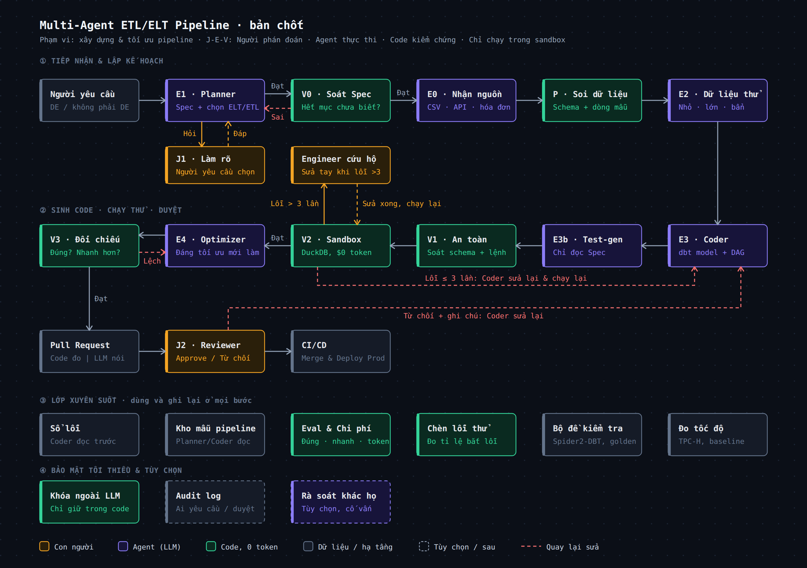
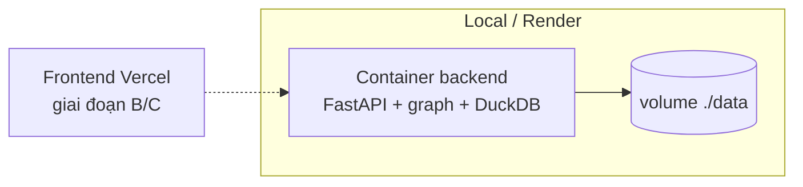

# Architecture Document

## System Overview

P-113 là agent nhiều bước (LangGraph) nhận yêu cầu dữ liệu bằng lời, sinh dự án dbt + DAG Airflow, chạy thử trong
sandbox DuckDB, tối ưu query có đo đạc, rồi dừng chờ Reviewer duyệt. Nguyên tắc **J-E-V**: con người quyết định (J),
agent thực thi (E), code thuần kiểm chứng (V, 0 token) — không dùng LLM để chấm LLM.

Mermaid + mô tả thành phần: [docs/architecture_diagram.md](docs/architecture_diagram.md).

## Components

### 1. Giao diện
- **CLI** (`src/cli.py`, giai đoạn A): `doctor`, `seed`, `run`, `answer`, `status`, `review`, `errors`, `optimize`.
  Vai trò `--as engineer|reviewer`; approve chỉ hợp lệ với reviewer khác người tạo yêu cầu.
- **API** (`src/api/`, FastAPI): `/health`, `/api/v1/status`, `/api/v1/runs`. Endpoint tạo/duyệt: Phase 7.
- **Web** (Next.js): giai đoạn B, chưa làm.

### 2. Runner (`src/agents/runner.py`)
- Mỗi lần chạy có `run_id` = `thread_id` của checkpointer SQLite.
- `start_run`, `resume_run`, `submit_review`: dùng chung cho CLI và API; kiểm tra quyền trước khi tiếp tục.
- Đồng bộ trạng thái + tóm tắt (token, chi phí, quyết định tối ưu) vào store.

### 3. AI Agent (LangGraph, `src/agents/graph.py`)
- **Kiểu:** graph tùy biến, có vòng lặp và điểm dừng con người.
- **State:** `PipelineState` (TypedDict, `total=False`); hợp đồng chi tiết ở `src/models/` lưu dạng dict.
- **Nodes:**

| Node | Loại | Việc |
|---|---|---|
| `planner` (E1) | LLM | Spec: nguồn, bảng đích, grain, cột, chỉ số, điểm chưa rõ, câu hỏi; mode do `decide_mode` (code) |
| `clarify` (J1) | Người | `interrupt` chờ chọn đáp án |
| `spec_check` (V0) | Code | Đủ trường, nguồn có thật, mode khớp tín hiệu, không còn điểm chưa rõ |
| `ingest` (E0) | Code | Nạp CSV (giữ chuỗi), JSON, SQLite vào schema `raw` |
| `profiler` (P) | Code | Kiểu, % rỗng, trùng khóa, định dạng ngày/tiền, mẫu che PII |
| `mock_data` (E2) | Code | Bộ small / large / dirty / empty / few / dupkeys (seed cố định) |
| `codegen` (E3) | LLM | Staging (ephemeral) + mart (table) + DAG; nhận lỗi trước, gợi ý sổ lỗi đã duyệt, ghi chú Reviewer |
| `testgen` (E3b) | Code + LLM | not_null, grain duy nhất (code); đối soát tổng tiền/số dòng (LLM, chỉ thấy spec + schema) |
| `safety` (V1) | Code | sqlglot: 1 câu SELECT, chặn DROP/ATTACH/INSTALL/COPY/PRAGMA/SET, hàm đọc file, đường dẫn tuyệt đối, Jinja lạ; bảng/cột phải có thật; kiểm tra DAG bằng AST |
| `sandbox_run` (V2) | Code | `dbt build` tiến trình con, timeout, `memory_limit`, `enable_external_access=false` |
| `rescue` | Người | Quá 3 lần sửa hoặc lỗi lặp 2 lần: nhập gợi ý hoặc dừng |
| `optimizer` (E4) | Code + LLM | 12 dấu hiệu chậm (sqlglot), baseline trung vị, ứng viên theo thứ tự: 7 luật tất định (có giả định + SQL kiểm chứng) → sqlglot.optimizer → LLM; mọi ứng viên qua V1 |
| `compare` (V3) | Code | So hai chiều (cả kiểu cột) trên 5 bộ dữ liệu; chạy SQL kiểm chứng giả định; đo trên `large`; cổng lợi ích tối thiểu + hòa vốn; không đạt → E4 thử ứng viên kế (≤ `OPT_MAX_ATTEMPTS`) |
| `package` | Code | Bằng chứng `measured` / `claimed`, `PULL_REQUEST.md` |
| `review` (J2) | Người | Approve / reject (ghi chú → Coder) |
| `finalize`, `fail` | Code | Kết thúc |

- **Tools:** `sql_tools` (sqlglot), `slow_patterns`, `rewrite_rules` (chuyển từ nhánh `feature/optimizer-agent`), `duckdb_tools`, `dbt_tools`, `pii`.

### 4. Lưu trữ
- **SQLite `data/app.db`:** bảng `runs`, `reviews`, `error_entries` (sổ lỗi).
- **SQLite `data/checkpoints.db`:** state LangGraph theo `run_id`.
- **Workspace `pipelines/workspaces/<run_id>/`:** dự án dbt, DAG, test, `sandbox.duckdb`, `datasets/*.duckdb`.

### 5. LLM service (`src/services/llm.py`)
- Cổng gọi LLM duy nhất; `LLM_PROVIDER=mock|openai`; prompt ở `src/prompts/*.md`, dữ liệu nằm trong khối `<data>`.
- Ghi token, chi phí ước tính, `simulated` cho mỗi lần gọi.

## Data Flow

1. Engineer gửi yêu cầu (CLI) → runner tạo `run_id` → Planner đọc danh mục nguồn thật (schema + mẫu đã che PII).
2. Còn điểm chưa rõ → dừng ở J1 → người chọn đáp án → Planner lập lại → V0.
3. Nạp nguồn vào sandbox → soi dữ liệu → sinh bộ dữ liệu thử.
4. Coder + Test-gen → V1 → V2 (vòng sửa) → Optimizer ⇄ V3.
5. Đóng gói bằng chứng → dừng ở J2 → Reviewer (khác người tạo) duyệt hoặc từ chối.

## Deployment Architecture

## Security

- Khóa API chỉ ở `.env`/secret của dịch vụ; không vào prompt; khóa giá trị mẫu bị coi là "chưa có".
- Tiến trình dbt chạy với môi trường đã bỏ các biến `*_API_KEY`, `*_TOKEN`, `*_SECRET`.
- Sandbox: DuckDB `enable_external_access=false`, timeout, giới hạn bộ nhớ; SQL sinh ra qua V1 trước khi chạy.
- Dữ liệu mẫu gửi LLM và hiển thị đều che email/số điện thoại.
- Hạn chế: chưa có đăng nhập; vai trò ở CLI là tham số.

## Design Decisions

| Decision | Choice | Reason |
|----------|--------|--------|
| Tạm dừng ở bước con người | LangGraph interrupt + SqliteSaver | [ADR 0001](docs/adr/0001-tam-dung-bang-langgraph-interrupt.md) |
| CLI, LLM mặc định | argparse, `mock` | [ADR 0002](docs/adr/0002-cli-argparse-va-mock-provider.md) |
| Kiểm chứng | Code thuần, Testgen mù code | [ADR 0003](docs/adr/0003-v-node-bang-code-va-testgen-mu-code.md) |
| Sandbox | DuckDB local + dbt-duckdb | Chạy được trên laptop/CI, không chạm production |
| Mặc định pipeline | ELT | Luật `decide_mode`: ETL khi PII hạn chế, nguồn không phải bảng, hoặc chỉ cần phần nhỏ dữ liệu lớn |
