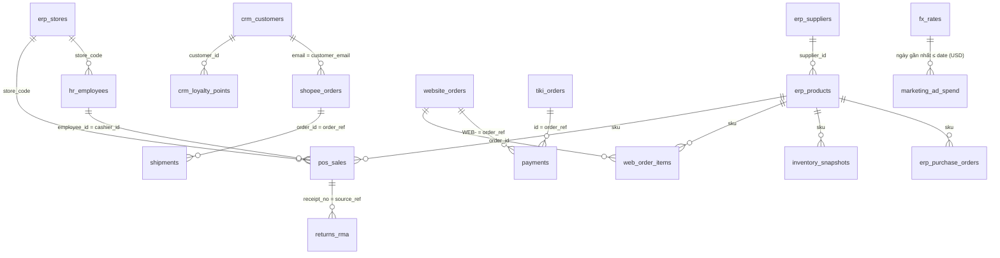

# Kho dữ liệu raw giả lập — "P113 Retail"

**P113 Retail** là công ty bán lẻ đa kênh **giả lập** (không phải công ty thật): 20 cửa hàng, 5 kho, bán online qua
Shopee, Tiki và website/app. Dữ liệu được sinh bằng code (`src/services/seed.py` + `src/services/company/`), seed cố
định nên chạy lại ra y hệt. Tên người, số điện thoại, CCCD là ngẫu nhiên; email dùng tên miền `example.com` (dành
riêng cho ví dụ). Thời gian giao dịch: tháng 9/2026.

Vì sao sinh dữ liệu thay vì tải bộ công khai: bộ dữ liệu bán lẻ công khai (ví dụ Olist trên Kaggle) cần đăng nhập,
quá lớn để đưa vào repo, và **không biết trước chỗ nào bẩn**. Ở đây mỗi kiểu bẩn được gài có chủ đích, nên có thể
kiểm tra agent có phát hiện và xử lý đúng hay không.

## Tạo dữ liệu

```powershell
python -m src.cli seed                            # đủ 19 bảng (mặc định), mức bẩn 5%
python -m src.cli seed --dirty 0.15 --scale 2     # bẩn hơn, gấp đôi số dòng
python -m src.cli seed --dirty 0                  # bản sạch (để so sánh)
python -m src.cli seed --profile basic            # chỉ 3 nguồn đơn online (bản nhỏ cho test)
```

Ghi vào `data/sources/` (không commit). API tự sinh bộ đầy đủ khi thư mục trống (Docker, Render). Quy mô mặc định:
19 bảng, khoảng 58.000 dòng, khoảng 5 MB; sinh mất khoảng 1 giây, E0 nạp cả 19 bảng mất khoảng 4 giây.

## 8 hệ thống, 19 bảng

| Hệ thống | File (định dạng) | Bảng raw | Số dòng* | Khóa |
|---|---|---|---:|---|
| Kênh online | `shopee_orders.csv` (CSV) | `shopee_orders` | 315 | `order_id` (SP00001) |
| | `tiki_orders.json` (JSON mảng) | `tiki_orders` | 300 | `id` (TK00001) |
| | `website.sqlite` (SQLite) | `website_orders` | 300 | `order_id` (số) |
| | `web_order_items.jsonl` (JSON từng dòng) | `web_order_items` | 623 | (`order_id`, `line_no`) |
| CRM | `crm.sqlite` (SQLite) | `crm_customers` | 4.105 | `customer_id` |
| | | `crm_loyalty_points` | 8.200 | `ledger_id` |
| ERP | `erp.sqlite` (SQLite) | `erp_products` | 600 | `product_id`, mã hàng `sku` |
| | | `erp_suppliers` | 42 | `supplier_id` |
| | | `erp_stores` | 25 | `store_code` |
| | | `erp_purchase_orders` | 1.500 | `po_id` |
| Bán tại cửa hàng | `pos_sales.csv` (CSV) | `pos_sales` | 21.502 | `line_id`; hóa đơn `receipt_no` |
| Kho vận & đổi trả | `inventory_snapshots.csv` | `inventory_snapshots` | 14.850 | (`snapshot_date`, `location_code`, `sku`) |
| | `shipments.json` (JSON lồng nhau) | `shipments` | 838 | `shipment_id` |
| | `returns_rma.csv` | `returns_rma` | 912 | `rma_id` |
| Thanh toán | `payments.parquet` (Parquet) | `payments` | 679 | `txn_id` |
| Marketing | `marketing_ad_spend.csv` | `marketing_ad_spend` | 913 | (`date`, `campaign_id`) |
| | `fx_rates.csv` | `fx_rates` | 22 | `rate_date` |
| Nhân sự & CSKH | `hr_employees.csv` | `hr_employees` | 600 | `employee_id` |
| | `support_tickets.jsonl` | `support_tickets` | 1.500 | `ticket_id` |

\* Số dòng đo thật với `seed` mặc định (`--dirty 0.05 --scale 1`), đã gồm dòng trùng gài sẵn.

`data/sources/systems.yml` ghi hệ thống và mô tả từng bảng. Màn **Dữ liệu nguồn** trên web đọc file này để nhóm bảng.

## Quan hệ giữa các bảng



Một số quan hệ không trùng tên cột (email, `cashier_id`, `order_ref` có tiền tố `WEB-`). Đó là thử thách thật:
màn web chỉ gợi ý được quan hệ trùng tên cột, phần còn lại agent phải suy ra từ dữ liệu mẫu.

## Các kiểu bẩn đã gài (đáp án để kiểm tra agent)

Tỉ lệ mỗi kiểu ≈ `dirty` × hệ số; với `--dirty 0` thì không có kiểu nào.

| Bảng | Kiểu bẩn | Cách xử lý mong đợi |
|---|---|---|
| `shopee_orders` | Ngày `dd/mm/yyyy` lẫn `yyyy-mm-dd`; tiền `"1.075.000"`; đơn trùng; tiền rỗng | Đọc cả hai định dạng; bỏ dấu chấm; bỏ trùng theo mã đơn |
| `web_order_items` | Khóa đổi tên `order_id` ↔ `orderId`; giá lồng `price.amount`; dòng trùng; 1 đơn mồ côi (99999); vài đơn tổng dòng ≠ tiền đơn | `coalesce(order_id, orderId)`; bỏ trùng; đối soát với `website_orders` |
| `crm_customers` | Cùng email đăng ký 2 mã; email hoa/thường/khoảng trắng; tài khoản test `test*@p113retail.vn`; thành phố nhiều cách viết (HCM, Sài Gòn, TPHCM); ngày sinh `1900-01-01`; giới tính M/F/Nam/Nữ/rỗng; tên không dấu | Chuẩn hóa email trước khi nối; loại tài khoản test; chuẩn hóa thành phố; coi 1900-01-01 là rỗng |
| `crm_loyalty_points` | Mã khách không tồn tại (`C999999`); giao dịch ghi trùng; thời điểm nhiều định dạng | Lọc mồ côi; bỏ trùng theo `ledger_id` |
| `erp_products` | Danh mục rỗng/viết hoa-thường; đơn vị tính nhiều cách viết; giá bán 0 hoặc < giá vốn; nhà cung cấp mồ côi (`S999`) | Gắn nhãn "chưa phân loại"; cảnh báo biên lợi nhuận âm |
| `erp_suppliers` | Cùng mã số thuế, hai mã nhà cung cấp, tên một bản không dấu | Gộp theo `tax_code` |
| `erp_stores` | Cửa hàng ST007 đóng ngày 31/08 (`closed_on`) nhưng POS vẫn ghi giao dịch tháng 9; vùng/thành phố viết lệch | Lọc cửa hàng đang hoạt động khi được yêu cầu; cờ giao dịch sau ngày đóng cửa |
| `erp_purchase_orders` | Nhận hàng trước ngày đặt; nhận thiếu/thừa; đơn chưa nhận (`received_at` rỗng); trạng thái hoa/thường | Cờ bất thường; không tính đơn chưa nhận vào nhập kho |
| `pos_sales` | Mã hàng gõ lệch (`sku-000123`, `SKU000123`, `000123`, khoảng trắng); mã không có trong ERP (`SKU-999999`); số lượng âm (trả hàng); giá gõ nhầm ×1000; giá nhiều định dạng (`1,075,000`, `1075000.0`, `1075k`, `1.075.000đ`); ngày `dd/mm/yyyy` lẫn kiểu Mỹ `mm/dd/yyyy AM/PM`; mã cửa hàng hoa/thường; cửa hàng `TEST`; xuất trùng nguyên một ngày của một cửa hàng; phương thức thanh toán nhiều cách viết | Chuẩn hóa `sku`/`store_code` (upper + trim + thêm `SKU-`); loại TEST; bỏ trùng theo (`receipt_no`, `line_no`); tách trả hàng; chặn giá bất thường |
| `inventory_snapshots` | Tồn âm; thiếu tuần thứ 3 của một điểm | Cờ tồn âm; không nội suy âm thầm |
| `shipments` | `created_at_ms` là epoch mili-giây; lịch sử trạng thái lồng nhau, có vận đơn thiếu bước; một đơn 2 vận đơn (giao lại); `order_ref` của website lúc `WEB-12` lúc `12`; tên hãng vận chuyển nhiều cách viết | `to_timestamp(ms/1000)`; `unnest(events)`; lấy vận đơn mới nhất |
| `returns_rma` | Một cột `source_ref` chứa cả mã đơn online lẫn số hóa đơn POS; lý do viết lệch/rỗng; tiền dạng chữ; mã tham chiếu không tồn tại; dòng trùng | Tách theo tiền tố; chuẩn hóa tiền |
| `payments` | Giờ lưu UTC (lệch 7 giờ so với giờ đơn); thất bại rồi thành công cho cùng đơn; số tiền lệch đơn vài nghìn; tên cổng hoa/thường | Đổi múi giờ trước khi gom theo ngày; chỉ lấy giao dịch SUCCESS |
| `marketing_ad_spend` | Google tính USD, kênh khác VND; tên kênh nhiều cách viết; click > lượt hiển thị; thiếu một ngày; kéo số liệu trùng | Quy đổi qua `fx_rates`; bỏ trùng theo (`date`, `campaign_id`) |
| `fx_rates` | Chỉ có ngày làm việc | Lấy tỉ giá ngày gần nhất trước đó (ASOF JOIN) |
| `hr_employees` | Số CCCD + lương (PII nhạy cảm); ngày nghỉ việc trước ngày vào làm; lương rỗng | Pipeline có cột này nên chọn ETL (che/bỏ PII trước khi vào kho) |
| `support_tickets` | Số điện thoại trong nội dung tự do (PII ẩn); trường `tags`/`resolved_at` chỉ có ở một số dòng; email hoa/thường | Che số điện thoại trong văn bản; không giả định đủ cột |

## Gợi ý yêu cầu để demo

- "Doanh thu bán tại cửa hàng theo ngày và theo danh mục sản phẩm, chỉ tính cửa hàng đang hoạt động": nối POS ↔ ERP qua mã hàng lệch, trả hàng, cửa hàng TEST, xuất trùng.
- "Chi phí quảng cáo quy ra VND theo ngày và kênh": quy đổi USD bằng tỉ giá ngày gần nhất.
- "Tỉ lệ giao thành công và thời gian giao trung bình theo hãng vận chuyển": epoch ms, mảng lồng nhau, vận đơn giao lại.
- "Danh sách khách hàng duy nhất kèm tổng điểm thưởng": gộp khách trùng email, loại tài khoản test, bỏ điểm mồ côi.
- "Bảng nhân viên theo cửa hàng cho bộ phận vận hành": có PII → agent nên chọn ETL.
