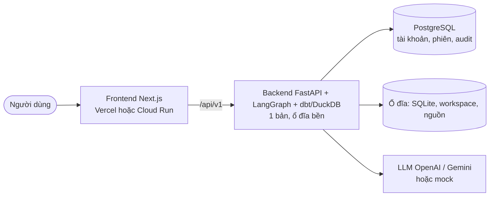

# Architecture Document

## System Overview

P-113 là agent nhiều bước (LangGraph) nhận yêu cầu dữ liệu bằng lời, sinh dự án dbt + DAG Airflow, chạy thử trong
sandbox DuckDB, tối ưu query có đo đạc, rồi dừng chờ Reviewer duyệt. Nguyên tắc **J-E-V**: con người quyết định (J),
agent thực thi (E), code thuần kiểm chứng (V, 0 token) — không dùng LLM để chấm LLM.

Mermaid + mô tả thành phần: [docs/architecture_diagram.md](docs/architecture_diagram.md).

## Components

### 1. Giao diện
- **CLI** (`src/cli.py`): `doctor`, `seed`, `run`, `answer`, `status`, `review`, `errors`, `optimize`, `eval`, `eval-verifiers`, `users`.
  Chạy trên máy chủ nên tin `--as engineer|reviewer`; web luôn dùng phiên đăng nhập.
- **API** (`src/api/`, FastAPI): đăng nhập/đăng xuất, quản trị tài khoản, tạo và duyệt lần chạy, catalog, sổ lỗi. Chi tiết: [docs/API.md](docs/API.md).
  Thao tác dài trả `202` rồi chạy nền (hàng đợi một luồng, `src/services/jobs.py`); web hỏi tiến trình định kỳ.
- **Web** (Next.js 16, `frontend/`): trang chủ theo vai trò, màn lần chạy (J1, J1b, cứu hộ, tiến trình), duyệt code (Monaco), tối ưu,
  cấu trúc và hồ sơ dữ liệu, sổ lỗi, quản trị.
- **Đăng nhập** (`src/services/auth.py`): tài khoản nội bộ (argon2id), phiên phía máy chủ, 3 vai trò `engineer` / `reviewer` / `admin`, nhật ký `audit_log`.

### 1b. Cửa kiểm tra, sổ nguồn, ngữ cảnh dữ liệu cho LLM (CLAUDE.md bản 2)
- **Cửa kiểm tra đầu vào (G0)** (`src/services/input_gate.py`, node `input_gate`): tầng 0 luật cố định, tầng 1 đối chiếu danh mục nghiệp vụ (code, 0 token), tầng 2 bộ phân loại model nhỏ (`input_gate` ở `config/models.yaml`). Chặn trước khi tạo lần chạy.
- **Sổ nguồn** (`src/services/source_registry.py`, bảng `departments`/`data_sources`/`source_grants`): `get_visible_sources(user)` là cửa duy nhất vào danh sách nguồn; người dùng chỉ thấy nguồn của phòng ban mình ([ADR 0007](docs/adr/0007-so-nguon-luu-cung-csdl-tai-khoan.md)).
- **`build_llm_context`** (`src/services/llm_context.py`): cửa duy nhất tạo ngữ cảnh dữ liệu cho prompt theo mức `llm_access` của nguồn ([ADR 0008](docs/adr/0008-muc-truy-cap-du-lieu-cua-llm.md)); lỗi vào prompt qua `scrub_error` (`src/agents/tools/scrub.py`).

- **Khung Extract** (`src/services/connectors/`): giao diện `SourceConnector` với hai nhóm hàm — cho LLM (`list_tables`, `get_schema`, `get_schema_fingerprint`, `get_profile`, `sample` chỉ ở mức `masked_sample`) và cho code (`load_to_sandbox`, `health_check`); ba bộ nạp `FileConnector`, `DuckDBConnector`, `PostgresConnector` (chỉ đọc, sqlglot kiểm từng câu).
- **Lựa chọn pipeline** (`PipelineOptions` trong spec): nạp toàn bộ/phần mới, lịch chạy, cách kết nối nguồn; code đề xuất kèm lý do, DE chọn ở J1b; Coder và V0 dùng.

### 2. Runner (`src/agents/runner.py`)
- Mỗi lần chạy có `run_id` = `thread_id` của checkpointer SQLite.
- `start_run`, `resume_run`, `submit_review`: dùng chung cho CLI và API; kiểm tra quyền trước khi tiếp tục.
- Đồng bộ trạng thái + tóm tắt (token, chi phí, quyết định tối ưu) vào store.

### 3. AI Agent (LangGraph, `src/agents/graph.py`)
- **Kiểu:** graph tùy biến, có vòng lặp và điểm dừng con người.
- **State:** `PipelineState` (TypedDict, `total=False`); hợp đồng chi tiết ở `src/models/` lưu dạng dict.
- **Nodes:**

| Node | Loại | Việc |
|---|---|---|
| `planner` (E1) | LLM | Spec: nguồn, bảng đích, grain, cột, chỉ số, điểm chưa rõ, câu hỏi; mode do `decide_mode` (code) |
| `clarify` (J1) | Người | `interrupt` chờ chọn đáp án |
| `spec_check` (V0) | Code | Đủ trường, nguồn có thật, mode khớp tín hiệu, không còn điểm chưa rõ, `references` trỏ tới model có thật |
| `plan_review` (J1b) | Người | DE đọc kế hoạch có giải thích, đồng ý hoặc yêu cầu sửa (bắt buộc ghi chú) trước khi tốn token sinh code ([ADR 0005](docs/adr/0005-duyet-ke-hoach-truoc-khi-sinh-code.md)) |
| `ingest` (E0) | Code | Nạp CSV (giữ chuỗi), JSON, SQLite vào schema `raw` |
| `profiler` (P) | Code | Kiểu, % rỗng, trùng khóa, định dạng ngày/tiền, mẫu che PII |
| `schema_guard` (Vs) | Code | So cấu trúc nguồn với bản Reviewer đã duyệt; cột bị xóa/nghi đổi tên thì dừng chờ Engineer xác nhận |
| `mock_data` (E2) | Code | Bộ small / large / dirty / empty / few / dupkeys / nullmoney (seed cố định) |
| `codegen` (E3) | LLM | Staging (ephemeral) + mart (table) + DAG; nhận lỗi trước, gợi ý sổ lỗi đã duyệt, ghi chú Reviewer |
| `testgen` (E3b) | Code + LLM | not_null, grain duy nhất (code); đối soát tổng tiền/số dòng (LLM, chỉ thấy spec + schema) |
| `safety` (V1) | Code | sqlglot: 1 câu SELECT, chặn DROP/ATTACH/INSTALL/COPY/PRAGMA/SET, hàm đọc file, đường dẫn tuyệt đối, Jinja lạ; bảng/cột phải có thật; kiểm tra DAG bằng AST |
| `sandbox_run` (V2) | Code | `dbt build` tiến trình con, timeout, `memory_limit`, `enable_external_access=false` |
| `rescue` | Người | Quá 3 lần sửa hoặc lỗi lặp 2 lần: nhập gợi ý hoặc dừng |
| `optimizer` (E4) | Code + LLM | 12 dấu hiệu chậm (sqlglot), baseline trung vị, ứng viên theo thứ tự: 7 luật tất định (có giả định + SQL kiểm chứng) → sqlglot.optimizer → LLM; mọi ứng viên qua V1 |
| `compare` (V3) | Code | So hai chiều (cả kiểu cột) trên 5 bộ dữ liệu; chạy SQL kiểm chứng giả định; đo trên `large`; cổng lợi ích tối thiểu + hòa vốn; không đạt → E4 thử ứng viên kế (≤ `OPT_MAX_ATTEMPTS`) |
| `package` | Code | Bằng chứng `measured` / `claimed`, `PULL_REQUEST.md` |
| `review` (J2) | Người | Approve / reject (ghi chú → Coder) |
| `finalize`, `fail` | Code | Kết thúc |

- **Tools:** `sql_tools` (sqlglot), `slow_patterns`, `rewrite_rules` (chuyển từ nhánh `feature/optimizer-agent`), `duckdb_tools`, `dbt_tools`, `pii`.

### 4. Lưu trữ
Chi tiết và cách xem: [docs/DATABASE.md](docs/DATABASE.md).
- **PostgreSQL 17 (Alembic):** `users`, `sessions`, `audit_log`, `schema_snapshots`; hai tài khoản `p113_migrator` / `p113_app`.
- **SQLite `data/app.db`:** bảng `runs`, `reviews`, `error_entries` (sổ lỗi). Chưa chuyển sang PostgreSQL (quyết định ở DATABASE.md).
- **SQLite `data/checkpoints.db`:** state LangGraph theo `run_id`.
- **Workspace `pipelines/workspaces/<run_id>/`:** dự án dbt, DAG, test, `sandbox.duckdb`, `datasets/*.duckdb`.

### 5. LLM service (`src/services/llm.py`)
- Cổng gọi LLM duy nhất; `LLM_PROVIDER=mock|openai`; prompt ở `src/prompts/*.md`, dữ liệu nằm trong khối `<data>`.
- Ghi token, chi phí ước tính, `simulated` cho mỗi lần gọi.

## Data Flow

1. Engineer gửi yêu cầu (web hoặc CLI) → runner tạo `run_id` → Planner đọc danh mục nguồn thật (schema + con số do code đếm, không có dòng dữ liệu; CLAUDE.md 2.3).
2. Còn điểm chưa rõ → dừng ở J1 → người chọn đáp án → Planner lập lại → V0 → J1b (DE duyệt kế hoạch).
3. Nạp nguồn vào sandbox → soi dữ liệu → so cấu trúc nguồn (Vs) → sinh bộ dữ liệu thử.
4. Coder + Test-gen → V1 → V2 (vòng sửa) → Optimizer ⇄ V3.
5. Đóng gói bằng chứng → dừng ở J2 → Reviewer duyệt hoặc từ chối (được duyệt cả yêu cầu do mình tạo, [ADR 0004](docs/adr/0004-mot-vai-tro-de.md)).

## Deployment Architecture

Backend chạy `dbt` bằng tiến trình con, ghi file DuckDB, dùng SQLite chế độ WAL và chạy agent nền sau khi trả `202`,
nên cần container/máy có ổ đĩa bền, không chạy kiểu serverless thuần. Hai cách triển khai: [Vercel + Render + Neon](docs/DEPLOY_VERCEL.md)
và [Google Cloud](docs/DEPLOY_GCP.md).

## Security

- Khóa API chỉ ở `.env`/secret của dịch vụ; không vào prompt; khóa giá trị mẫu bị coi là "chưa có".
- Tiến trình dbt chạy với môi trường đã bỏ các biến `*_API_KEY`, `*_TOKEN`, `*_SECRET`.
- Sandbox: DuckDB `enable_external_access=false`, timeout, giới hạn bộ nhớ; SQL sinh ra qua V1 trước khi chạy.
- Dữ liệu mẫu gửi LLM và hiển thị đều che email/số điện thoại.
- Đăng nhập bắt buộc cho mọi API trừ `/health`, đăng nhập/đăng xuất; sai vai trò → 403 và ghi `audit_log`; cookie phiên HttpOnly, thao tác ghi cần header `X-Requested-With`.
- Mật khẩu băm argon2id, khóa tạm sau nhiều lần sai (`LOGIN_MAX_FAILURES`); tài khoản ứng dụng PostgreSQL không có quyền đổi cấu trúc.
- Hạn chế: CLI chạy trên máy chủ nên tin tham số `--as/--user`.

## Design Decisions

| Decision | Choice | Reason |
|----------|--------|--------|
| Tạm dừng ở bước con người | LangGraph interrupt + SqliteSaver | [ADR 0001](docs/adr/0001-tam-dung-bang-langgraph-interrupt.md) |
| Vai trò duyệt | Một vai trò DE tự duyệt được; sau đó thay bằng đăng nhập 3 vai trò (2026-10-08) | [ADR 0004](docs/adr/0004-mot-vai-tro-de.md), [JOURNAL](JOURNAL.md) |
| Duyệt kế hoạch trước khi sinh code | Bước J1b | [ADR 0005](docs/adr/0005-duyet-ke-hoach-truoc-khi-sinh-code.md) |
| CLI, LLM mặc định | argparse, `mock` | [ADR 0002](docs/adr/0002-cli-argparse-va-mock-provider.md) |
| Kiểm chứng | Code thuần, Testgen mù code | [ADR 0003](docs/adr/0003-v-node-bang-code-va-testgen-mu-code.md) |
| Sandbox | DuckDB local + dbt-duckdb | Chạy được trên laptop/CI, không chạm production |
| Mặc định pipeline | ELT | Luật `decide_mode`: ETL khi PII hạn chế, nguồn không phải bảng, hoặc chỉ cần phần nhỏ dữ liệu lớn |
