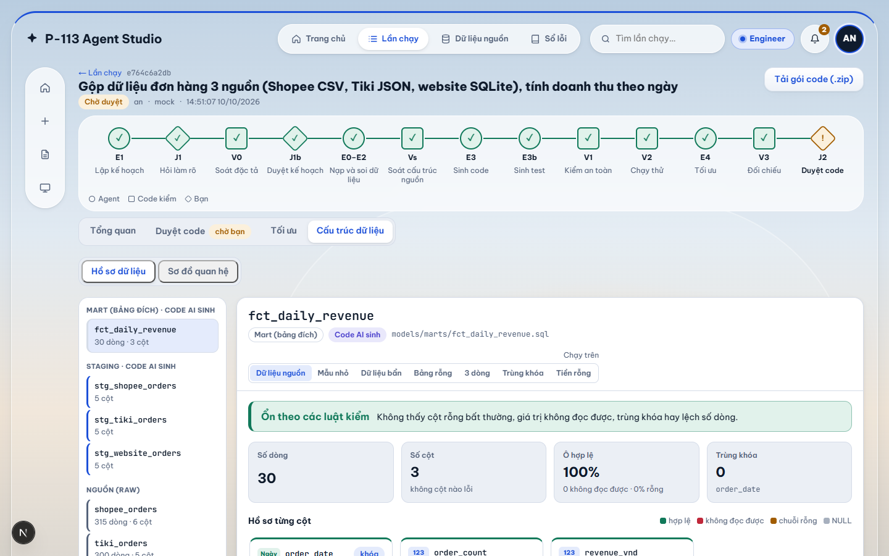
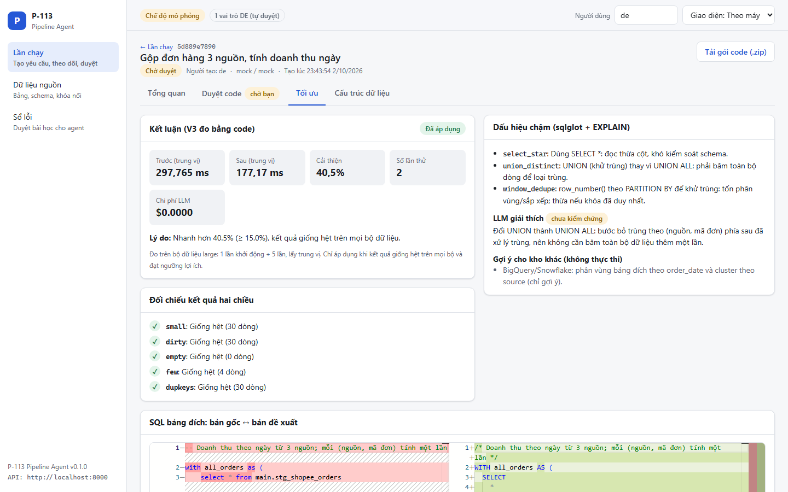

# P-113 — Agent viết & tối ưu pipeline ELT/ETL

[](https://github.com/TrungTuyenDo02/AI_Agent_Pipeline_ETL-ELT/actions/workflows/ci.yml)

> Tóm tắt 1 câu: data engineer mất nhiều giờ viết lặp lại pipeline dbt/Airflow và dò query chậm → agent LangGraph nhận yêu cầu bằng lời,
> sinh model dbt + DAG Airflow, chạy thử trong sandbox DuckDB, đo và tối ưu query, rồi để Reviewer duyệt trước khi merge.

**Live URL:** chưa có (giai đoạn C) • **Video demo:** chưa có • **Hướng dẫn chạy chi tiết:** [docs/RUNBOOK.md](docs/RUNBOOK.md)

## Ảnh chụp màn hình

Chụp ở chế độ mô phỏng (`LLM_PROVIDER=mock`), dữ liệu giả lập.

| Cấu trúc dữ liệu (raw → staging → mart, schema, lineage) | Duyệt code (Monaco) + bằng chứng |
|---|---|
|  |  |
| **Duyệt kế hoạch J1b** (các bước + vì sao, trước khi sinh code) | **Tối ưu** (trước/sau, đối chiếu từng bộ dữ liệu) |
|  |  |

## Vấn đề (Problem)

- **Ai gặp:** data engineer (DE) trong đội dữ liệu; người không phải DE nhưng cần pipeline (vận hành, kinh doanh).
- **Đau ở đâu:** mỗi yêu cầu kiểu "gộp đơn hàng 3 nguồn, tính doanh thu ngày" lại phải viết staging, mart, test, DAG
  gần giống nhau; dữ liệu bẩn (trùng đơn, ngày lẫn định dạng, tiền `1.075.000`) dễ làm sai số liệu; query chậm ít ai rảnh tối ưu.
- **Vì sao công cụ hiện có chưa đủ:** trợ lý sinh code thường không chạy thử, không tự kiểm chứng kết quả, và tự báo "xong"
  mà không có bằng chứng — rủi ro cao nếu chạy thẳng trên production.

## Giải pháp (Solution)

Nguyên tắc **J-E-V**: con người **phán đoán** (J), agent **thực thi** (E), code thuần **kiểm chứng** (V, 0 token).

- **Hỏi trước khi làm:** Planner liệt kê điểm chưa rõ và hỏi dạng trắc nghiệm (J1); còn điểm chưa rõ thì không sinh code.
- **Duyệt kế hoạch trước khi sinh code (J1b):** agent trình bày kế hoạch bằng lời thường, từng bước có giải thích "vì sao"; DE đồng ý hoặc ghi chú để agent lập lại.
- **Sinh pipeline đầy đủ:** model dbt (staging + mart), DAG Airflow, test đối soát do một agent khác viết **không nhìn code**.
- **Kiểm chứng bằng code:** chặn lệnh nguy hiểm và tên bảng/cột bịa (sqlglot), chạy `dbt build` trong sandbox DuckDB
  (không truy cập file ngoài, có timeout), tối đa 3 vòng sửa rồi chuyển con người cứu hộ.
- **Tối ưu có đo đạc:** phát hiện dấu hiệu chậm; thử luật viết lại tất định và sqlglot trước, LLM sau cùng; chỉ áp dụng khi kết quả **giống hệt**
  trên 5 bộ dữ liệu và nhanh hơn ngưỡng; không đáng thì ghi "giữ nguyên" kèm lý do.
- **Duyệt có bằng chứng:** Reviewer xem diff + bảng **"Code đo | LLM nói"**; người tạo yêu cầu không được tự duyệt.

## Target User

- **Primary:** data engineer (DE) bận rộn — xem code, diff, số đo; đóng vai Engineer (tạo yêu cầu) hoặc Reviewer (duyệt).
- **Secondary:** người không phải DE nhưng cần pipeline (vận hành, kinh doanh) — mô tả nghiệp vụ, xem kế hoạch bằng lời và kết quả mẫu.
- **Quản trị (Admin):** cấp và khóa tài khoản. Phần mềm nội bộ, không có đăng ký tự do.

## Sơ đồ kiến trúc


Bản vector: [docs/adr/architecture.svg](docs/adr/architecture.svg) • bản mở trình duyệt: [docs/adr/architecture.html](docs/adr/architecture.html) •
mô tả từng khối + Mermaid: [ARCHITECTURE.md](ARCHITECTURE.md), [docs/architecture_diagram.md](docs/architecture_diagram.md).

| Khối | Loại | Việc |
|---|---|---|
| E1 Planner ⇄ J1 | LLM + người | Lập đặc tả, chọn ELT/ETL (luật cố định), hỏi làm rõ |
| J1b Duyệt kế hoạch | Người | DE đọc kế hoạch có giải thích, đồng ý hoặc yêu cầu sửa (trước khi tốn token sinh code) |
| V0 Soát spec | Code | Chặn nếu còn điểm chưa biết, thiếu trường, mode sai tín hiệu |
| E0 Nhận nguồn → P Soi dữ liệu → E2 Dữ liệu thử | Code | Nạp CSV/JSON/SQLite; hồ sơ cột (đã che PII); bộ small/large/dirty/empty/few/dupkeys/nullmoney |
| E3 Coder → E3b Test-gen | LLM | dbt model + DAG; test đối soát chỉ từ spec + schema |
| V1 An toàn → V2 Sandbox | Code | sqlglot + `dbt build` trên DuckDB; lỗi → sửa (≤3), lỗi lặp → cứu hộ |
| E4 Optimizer ⇄ V3 Đối chiếu | LLM + code | Đề xuất viết lại; đối chiếu hai chiều, đo tốc độ, quyết định applied/skipped |
| Pull Request → J2 Reviewer | Người | Approve / từ chối kèm ghi chú (quay lại Coder) |

## Tech Stack

| Layer | Technology |
|---|---|
| Agent | LangGraph 1.2 (interrupt + checkpointer SQLite), LangChain OpenAI |
| LLM | `mock` (mặc định, không cần khóa); OpenAI theo từng bước (`gpt-5.6-luna` cho planner/codegen/testgen, `gpt-5.6-terra` cho optimizer); dự phòng Google Gemini `gemini-3.1-flash-lite` |
| Sandbox | DuckDB 1.5, dbt-core 1.12 + dbt-duckdb, sqlglot 30 |
| Backend | FastAPI + Uvicorn, Python 3.11+ |
| Database | PostgreSQL 16 (tài khoản, phiên, `audit_log`; SQLAlchemy 2 + Alembic) • SQLite (lần chạy, duyệt, sổ lỗi — chuyển sang PostgreSQL ở bước sau) |
| Terminal | argparse + rich |
| Frontend | Next.js 16 (App Router) + TypeScript, `@monaco-editor/react` (diff code), sơ đồ dữ liệu SVG tự vẽ |
| DevOps | Docker multi-stage (backend + frontend standalone), docker compose, GitHub Actions (lint → test, frontend → build) |

## Quick Start

```bash
# 1. Clone repo
git clone https://github.com/TrungTuyenDo02/AI_Agent_Pipeline_ETL-ELT.git
cd AI_Agent_Pipeline_ETL-ELT

# 2. Setup environment
cp .env.example .env                  # Windows: Copy-Item .env.example .env
# Điền các biến còn trống trong .env (chỉ cần khóa LLM khi dùng LLM thật; mặc định LLM_PROVIDER=mock)

# 3. Install dependencies
python -m venv .venv && source .venv/bin/activate     # Windows: .\.venv\Scripts\Activate.ps1
pip install -r requirements.txt

# 4. Database (đăng nhập + nhật ký kiểm toán) và tài khoản mẫu
docker compose up -d db               # PostgreSQL cục bộ
alembic upgrade head
python -m src.cli users seed-dev      # tài khoản mẫu an/binh/quantri, mật khẩu ngẫu nhiên in một lần

# 5. Run development server
uvicorn src.main:app --reload         # API http://localhost:8000/docs
```

### Chi tiết các cách chạy

#### Terminal (giai đoạn A — không cần khóa API)

```powershell
python -m venv .venv
.\.venv\Scripts\Activate.ps1          # Linux/macOS: source .venv/bin/activate
pip install -r requirements.txt
Copy-Item .env.example .env           # Linux/macOS: cp .env.example .env
python -m src.cli doctor              # kiểm tra môi trường
python scripts/tasks.py demo          # kịch bản mẫu trọn vẹn (máy có make: make demo)
```

Tự chạy từng bước:

```powershell
python -m src.cli seed
python -m src.cli run --request "Gộp dữ liệu đơn hàng 3 nguồn, tính doanh thu ngày" --as engineer --user an
python -m src.cli review latest --as reviewer --user binh
python -m src.cli status
```

#### Web trên máy (giai đoạn B)

```powershell
python scripts/tasks.py run           # API ở http://localhost:8000 (make run)
cd frontend; npm ci; cd ..            # một lần
python scripts/tasks.py frontend-dev  # web ở http://localhost:3000 (make frontend-dev)
```

Giao diện thiết kế cho laptop (≥1280px), vẫn dùng được trên màn nhỏ; có giao diện sáng/tối. Các màn hình:

| Màn | Việc DE làm |
|---|---|
| Lần chạy | Tạo yêu cầu bằng lời, xem danh sách lần chạy, lần nào đang chờ mình |
| Tổng quan lần chạy | Trả lời câu hỏi làm rõ (J1), **duyệt kế hoạch có giải thích (J1b)**, cứu hộ, xem tiến trình ✓/✗ từng bước, đặc tả, kết quả mẫu, token/chi phí |
| Duyệt code | Monaco: code dbt/DAG/test (vòng sau: diff với bản đã từ chối), bằng chứng "Code đo \| LLM nói", duyệt/từ chối, tải gói `.zip` |
| Tối ưu | Thời gian trước/sau, đối chiếu kết quả từng bộ dữ liệu, dấu hiệu chậm, diff SQL gốc ↔ bản tối ưu |
| Cấu trúc dữ liệu | Sơ đồ raw → staging → mart, schema từng bảng (kiểu, % rỗng, khóa, trùng khóa), lineage, khóa JOIN |
| Dữ liệu nguồn • Sổ lỗi | 19 bảng raw nhóm theo 8 hệ thống, số dòng, % rỗng, trùng khóa, khóa nối gợi ý kèm % dòng khớp • duyệt bài học cho agent |

#### Docker

```powershell
docker compose up --build             # web http://localhost:3000 • API http://localhost:8000/health
$env:LLM_PROVIDER="mock"; docker compose up --build   # ép chế độ mô phỏng dù .env đang chọn openai
```

Dữ liệu của bản Docker nằm trong volume riêng (`backend-data`, `backend-workspaces`), tách với `data/` trên máy;
lần đầu chạy API tự sinh dữ liệu mẫu.

#### Kiểm thử

```powershell
python scripts/tasks.py ci            # giống CI: ruff check → ruff format --check → pytest (độ phủ ≥ 60%)
```

### Biến môi trường

Xem giá trị mẫu trong [.env.example](.env.example). Chỉ cần đổi khi muốn dùng LLM thật.

`LLM_PROVIDER`, `OPENAI_API_KEY`, `GOOGLE_API_KEY`, `MODEL_NAME`, `MODEL_PLANNER`, `MODEL_CODEGEN`, `MODEL_TESTGEN`, `MODEL_OPTIMIZER`, `LLM_FALLBACK`, `GOOGLE_MODEL_NAME`, `LLM_TEMPERATURE`, `LLM_MAX_TOKENS`, `LLM_STRUCTURED_OUTPUT`, `DATABASE_URL`, `MIGRATION_DATABASE_URL`, `TEST_DATABASE_URL`, `POSTGRES_PASSWORD`, `P113_MIGRATOR_PASSWORD`, `P113_APP_PASSWORD`, `SESSION_SECRET`, `SESSION_TTL_MINUTES`, `SESSION_COOKIE_SECURE`, `SESSION_COOKIE_SAMESITE`, `LOGIN_MAX_FAILURES`, `LOGIN_LOCK_MINUTES`, `FORCE_HTTPS`, `APP_ENV`, `APP_PORT`, `APP_HOST`, `CORS_ORIGINS`, `LOG_LEVEL`, `SANDBOX_TIMEOUT_SEC`, `SANDBOX_MEMORY_LIMIT`, `MAX_FIX_ATTEMPTS`, `OPT_MIN_GAIN_PCT`, `OPT_RUNS_PER_MONTH`, `OPT_MAX_ATTEMPTS`, `MOCK_LARGE_ROWS`, `LANGCHAIN_API_KEY`, `LANGCHAIN_PROJECT`, `AI_LOG_SERVER`, `AI_LOG_API_KEY`, `AI_LOG_DIR`.

Bí mật (khóa API, mật khẩu, `SESSION_SECRET`) chỉ nằm trong `.env` (đã git-ignore) hoặc dịch vụ quản lý bí mật khi triển khai, không bao giờ vào Git hay log.

## API Endpoints

Swagger: <http://localhost:8000/docs>. Thao tác làm agent chạy tiếp trả `202` ngay (chạy nền, xếp hàng lần lượt);
web hỏi `GET /runs/{id}` định kỳ để xem tiến trình. Mọi API (trừ `POST /auth/login`, `/auth/logout`, `/health`) cần
đăng nhập (cookie phiên HttpOnly): chưa đăng nhập → `401`, sai vai trò → `403` (ghi `audit_log`). Thao tác ghi phải kèm
header `X-Requested-With`. Lỗi trả `detail` tiếng Việt, không lộ traceback.

Đăng nhập (tài khoản do doanh nghiệp cấp, không có đăng ký): `POST /auth/login`, `POST /auth/logout`, `GET /auth/me`;
Admin: `GET/POST /admin/users`, `PATCH /admin/users/{id}`, `GET /admin/audit`. Cấu trúc nguồn (mục 8): `GET /catalog/schema-changes` (kiểm lúc nhận), `POST /runs/{id}/schema` (Engineer xác nhận khi nguồn mất cột). Vai trò: **engineer** (tạo yêu cầu, trả lời, duyệt kế hoạch,
cứu hộ), **reviewer** (duyệt/từ chối code, duyệt sổ lỗi), **admin** (quản lý tài khoản). Cài lần đầu:

```bash
docker compose up -d db                      # PostgreSQL cục bộ (điền mật khẩu trong .env trước, xem .env.example)
alembic upgrade head                         # tài khoản migration (MIGRATION_DATABASE_URL)
python -m src.cli users seed-dev             # tài khoản mẫu an/binh/quantri, mật khẩu ngẫu nhiên in một lần
```

| Method | Path | Mô tả |
|---|---|---|
| GET | `/health` | Trạng thái dịch vụ (`status`, `timestamp`, `version`, `database`, `llm_provider`) |
| GET | `/api/v1/status` | LLM đang dùng, có phải mô phỏng không, chế độ duyệt |
| POST | `/api/v1/runs` | Tạo yêu cầu (`request_text`) → `run_id`, agent chạy nền |
| GET | `/api/v1/runs` • `/runs/{id}` | Danh sách • chi tiết: trạng thái, câu hỏi đang chờ, tiến trình từng bước, đặc tả, bằng chứng, báo cáo tối ưu |
| GET | `/api/v1/runs/{id}/files` | Code + test hiện tại và bản vòng trước (xem diff) |
| GET | `/api/v1/runs/{id}/download` | Gói `.zip` code dbt + test + DAG (không kèm dữ liệu sandbox) để đưa vào repo, mở PR |
| POST | `/api/v1/runs/{id}/answers` | Trả lời câu hỏi làm rõ (J1) |
| POST | `/api/v1/runs/{id}/plan` | Duyệt kế hoạch (J1b): `approve`, hoặc `revise` kèm `note` |
| POST | `/api/v1/runs/{id}/review` | Duyệt / từ chối kèm ghi chú (J2) |
| POST | `/api/v1/runs/{id}/rescue` | Cứu hộ: gợi ý rồi thử lại, hoặc dừng |
| GET | `/api/v1/reviews/queue` | Các lần chạy chờ duyệt |
| GET/POST | `/api/v1/errors` • `/errors/{id}/approve` • `/errors/{id}/discard` | Sổ lỗi |
| GET | `/api/v1/catalog/sources` | Bảng nguồn + schema + gợi ý khóa nối theo tên cột |
| GET | `/api/v1/runs/{id}/catalog` | Cấu trúc một lần chạy: raw → staging → mart, kiểu cột, % rỗng, khóa, lineage, JOIN thật (0 token) |
| GET | `/api/v1/catalog/sources/profile?table=` | Hồ sơ dữ liệu một bảng nguồn: chất lượng + phân bố từng cột, vấn đề, 50 dòng xem trước đã che PII (Engineer/Reviewer) |
| GET | `/api/v1/runs/{id}/profile?table=&dataset=` | Như trên cho bảng của lần chạy, kể cả staging/mart do code AI sinh; `dataset` = sandbox / small / dirty / dupkeys / nullmoney / few / empty |

## Project Structure

```
src/
  cli.py, cli_commands.py, cli_views.py   Giao diện dòng lệnh
  agents/
    graph.py, routing.py, state.py        Graph LangGraph, hàm rẽ nhánh, state (TypedDict)
    runner.py, progress.py                Chạy/tạm dừng/tiếp tục theo run_id, dòng tiến trình
    nodes/                                Mỗi node một file (planner, spec_check, ingest, ... , review)
    tools/                                sql_tools (sqlglot), duckdb_tools, dbt_tools, pii
  api/                                    health, auth (đăng nhập/đăng xuất, admin), routes, runs, reviews, catalog, error_book
  models/                                 Hợp đồng Pydantic: spec, evidence, schemas
  services/                               llm (+ llm_mock), store, error_memory, seed, doctor, cost, tracing,
                                          company/ (kho raw giả lập P113 Retail), catalog, source_catalog, export, jobs
  prompts/                                Prompt của planner, codegen, testgen, optimizer
pipelines/template/                       Dự án dbt mẫu; workspaces/ sinh lúc chạy (git-ignored)
tests/                                    test_api, test_agents, test_verifiers, test_optimizer, test_services, test_cli
docs/                                     RUNBOOK, adr/ (quyết định + sơ đồ), architecture_diagram.md, guide/
migrations/, alembic.ini                  Alembic: bảng users, phiên, audit_log, ảnh chụp cấu trúc nguồn
frontend/                                 Next.js: app/ (login, admin, catalog, run), components/
scripts/                                  seed_data.py, tasks.py (thay make trên Windows), hook ghi log AI
```

## Kết quả đánh giá (Evaluation)

Chỉ ghi số đã đo thật (2026-10-02, Windows, Python 3.11.9). Tổng hợp tự động: [eval/results/report.md](eval/results/report.md)
(`make eval`). Cột "LLM thật" dùng **openai**: planner/codegen/testgen = `gpt-5.6-luna`, optimizer = `gpt-5.6-terra`.

**Phần kiểm chứng bằng code (không cần LLM, chạy trong CI):**

| Chỉ số | Giá trị | Ghi chú |
|---|---|---|
| Test tự động | 280 passed | `pytest`, độ phủ 90,1% (ngưỡng 60%) |
| Mutation test: bộ kiểm chứng bắt lỗi giả | **11/12 (91,7%)**, 0/1 báo động nhầm | SUM→AVG, bỏ WHERE, bỏ khử trùng, đọc sai ngày/tiền, quên nguồn...; [mutation.md](eval/results/mutation.md) |
| Golden: kết quả đúng (tính tay) khớp SQL chuẩn | 11/11 | [golden_reference.md](eval/results/golden_reference.md) |
| TPC-H sf=0.1: 13 query chậm cố ý | 11/13 áp dụng, nhanh hơn 51%–94,7% | 10/11 nhờ luật tất định (0 token); [tpch_benchmark.md](eval/results/tpch_benchmark.md) |
| ELT-Bench: bộ chấm kiểm bằng model chuẩn | 3/3 khớp | [eltbench_reference.md](eval/results/eltbench_reference.md) |

**Agent chạy bằng LLM thật:**

| Chỉ số | Giá trị | Ghi chú |
|---|---|---|
| Golden 12 ca (trùng đơn, hoàn tiền, ngày lẫn định dạng, nối một-nhiều, PII...) | **12/12 đúng**; 12/12 chọn đúng ELT/ETL; 10/12 không phải sửa vòng nào | ~43 s và ~0,0055 USD mỗi ca; [golden_agent.md](eval/results/golden_agent.md) |
| Hỏi làm rõ khi yêu cầu mơ hồ | Có (2 câu) ở yêu cầu mơ hồ; 0 câu ở 11 yêu cầu đã rõ | ca g10 |
| Kịch bản "gộp 3 nguồn, doanh thu ngày" × 5 lần | 5/5 tới bản duyệt; 4/5 không phải sửa vòng nào | ~19,6 nghìn token, ~0,02 USD/lần (gpt-4o-mini cùng kịch bản: 4/5) |
| ELT-Bench-Verified: agent tự xây 34 bảng (10 pipeline công khai) | **7/34 khớp bảng đúng**; 27/34 đi trọn luồng tới bản duyệt | Bảng còn lại lệch nghĩa so với định nghĩa của benchmark; tổng 0,94 USD; [eltbench_agent.md](eval/results/eltbench_agent.md) |
| Optimizer "tối ưu chỉ khi đáng" | 1 lần nhanh hơn 39,6% nhưng tiết kiệm/năm < chi phí tối ưu → giữ nguyên | đúng luật thiết kế |

## Hạn chế đã biết

- Chưa chạy trên dữ liệu công ty thật; dùng kho raw giả lập của công ty bán lẻ "P113 Retail" (8 hệ thống, 19 bảng, bẩn có chủ đích, seed cố định — [docs/data-catalog.md](docs/data-catalog.md)).
- Kết quả chạy bằng `mock` không phản ánh chất lượng mô hình thật; Planner/Coder mock được viết sẵn cho kịch bản doanh thu ngày.
- Chỉ Reviewer được duyệt; Reviewer được duyệt cả yêu cầu do mình tạo (người dùng chọn, ADR 0004).
- Đăng nhập/nhật ký kiểm toán đã ở PostgreSQL; lần chạy, quyết định duyệt, sổ lỗi vẫn ở SQLite (chuyển ở bước sau).
- CLI chạy trên máy chủ nên tin `--as/--user` (người vào được máy chủ đã có quyền cao hơn); web luôn dùng phiên đăng nhập.
- Sandbox chỉ DuckDB local; gợi ý partition/cluster cho kho khác chỉ là gợi ý, không thực thi.
- Chưa có Live URL (giai đoạn C). Web: các lần chạy xếp hàng lần lượt; nhật ký từng bước giữ trong bộ nhớ API (mất khi khởi động lại, kết quả vẫn còn); trình xem code Monaco tải từ CDN jsDelivr nên cần mạng.

## AI usage logging

Mọi prompt được ghi vào `.ai-log/session.jsonl` và tự động gửi lên grading server ở bước pre-push.
Cài hook một lần sau khi clone:

```bash
bash scripts/setup_hooks.sh                                      # Linux / macOS / Git Bash
powershell -ExecutionPolicy Bypass -File scripts\setup_hooks.ps1 # Windows PowerShell
```

| Công cụ | Cấu hình | Thời điểm ghi |
|---|---|---|
| Claude Code | `.claude/settings.json` | mỗi prompt (`UserPromptSubmit`) |
| Cursor | `.cursor/hooks.json` | mỗi prompt và khi dừng |
| OpenAI Codex CLI | `.codex/hooks.json` | mỗi prompt và khi dừng |
| Gemini CLI | `.gemini/settings.json` | mỗi lượt agent chạy |
| GitHub Copilot | `.github/hooks/hooks.json` | mỗi prompt và cuối session |
| Antigravity IDE | `.agents/hooks.json` | mỗi prompt, kèm lần quét lại lúc `git push` |

Dùng ChatGPT hay công cụ web khác thì log thủ công:

```bash
bash scripts/_pyrun.sh scripts/log_manual.py --tool chatgpt --prompt "What you asked"
```

Mỗi thành viên tự tạo `AI_LOG_API_KEY` tại [dashboard Phoenix](https://phoenix.note.transformerlabs.ai/api-keys) và điền vào `.env`.

## Deliverables Checklist

- [x] Source code (`src/`)
- [x] README.md
- [x] Architecture diagram (`docs/adr/architecture.png`, `docs/architecture_diagram.md`)
- [x] AI logs (hook tự động; LangSmith tùy chọn)
- [ ] Live URL / Deploy
- [ ] Video demo (`docs/video-demo.md`)
- [ ] Pitch deck (`presentation/`)
- [x] Weekly journal (`JOURNAL.md`)
- [x] Worklog (`WORKLOG.md`)
- [ ] Evaluation evidence (`eval/results/report.md`)

## Team

| Member | Role | Student ID |
|--------|------|-----------|
| TrungTuyenDo02 | Toàn bộ hệ thống | — |

## License

[MIT](LICENSE)
