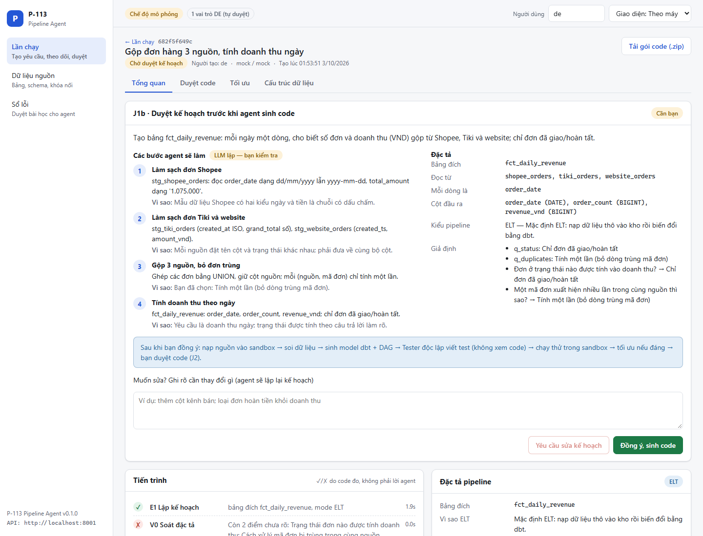
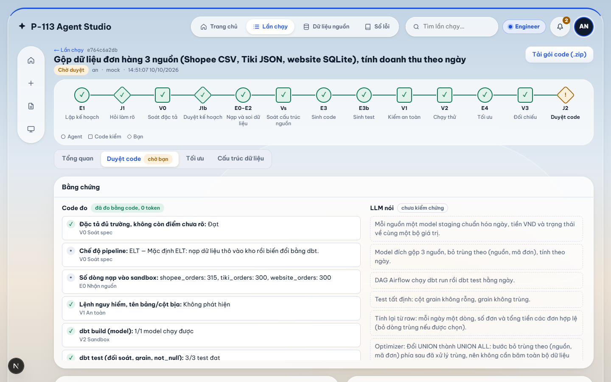

# P-113 — Agent viết và tối ưu pipeline ELT/ETL

[](https://github.com/TrungTuyenDo02/AI_Agent_Pipeline_ETL-ELT/actions/workflows/ci.yml)

> Nói bằng lời bạn cần bảng dữ liệu gì → agent sinh dbt + DAG Airflow, chạy thử trong sandbox, đo và tối ưu query, rồi **chờ người duyệt** trước khi merge.

**Live URL:** chưa có (chưa deploy) • **Video demo:** chưa có ([kịch bản](docs/video-demo.md)) • **Báo cáo:** [docs/BAO_CAO.md](docs/BAO_CAO.md)

## Demo

Chụp ở chế độ mô phỏng (`LLM_PROVIDER=mock`), dữ liệu giả lập.

| Duyệt kế hoạch (J1b), trước khi sinh code | Duyệt code: bằng chứng "Code đo \| LLM nói" |
|---|---|
|  |  |

## Vấn đề → Giải pháp

DE mất nhiều giờ viết lặp staging, mart, test, DAG; dữ liệu bẩn (đơn trùng, ngày lẫn định dạng, tiền `1.075.000`) làm sai số; trợ lý sinh code thường không chạy thử mà vẫn báo "xong".
Nguyên tắc **J-E-V**: người **phán đoán** (J), agent **thực thi** (E), code thuần **kiểm chứng** (V, 0 token).

- **Cửa kiểm tra đầu vào 3 tầng:** tầng 0–1 bằng code (0 token, luật trong [config/input_gate.yaml](config/input_gate.yaml)) chặn yêu cầu rỗng, vô nghĩa, tấn công prompt hoặc lạc đề trước Planner, kèm ví dụ hợp lệ lấy từ danh mục thật; tầng 2 chỉ gọi model nhỏ (≈ 0,000055 USD/lượt) khi tầng 1 chưa chắc, thiếu thông tin thì hỏi bổ sung theo mẫu cố định thay vì từ chối thẳng. Có trần token mỗi lần chạy, số vòng hỏi làm rõ và số lần chạy mỗi ngày.
- **Chống prompt injection:** dữ liệu đưa vào prompt nằm trong thẻ `<data>` không thể bị đóng sớm; hồ sơ dữ liệu và sổ lỗi có nội dung nghi ngờ được cảnh báo cho người duyệt; môi trường dbt không mang mật khẩu, `DATABASE_URL`, `SESSION_SECRET`.
- **Giới hạn theo người:** tối đa 2 lần chạy cùng lúc mỗi người (có vị trí hàng đợi), trần chi phí LLM mỗi người mỗi ngày (giữ trước trước mỗi lượt gọi thật, sổ chi phí ghi cả lượt thất bại và "Hỏi AI", [ADR 0014](docs/adr/0014-so-chi-phi-va-giu-truoc-ngan-sach-llm.md)), lần chạy kẹt khi server khởi động lại được đánh dấu để cứu.
- **Tạm dừng / tiếp tục:** người tạo yêu cầu dừng được lần chạy đang chạy hoặc đang xếp hàng; bước đang chạy chạy xong rồi dừng trước bước kế tiếp (checkpoint giữ nguyên), tiếp tục không làm lại bước đã xong. Tiếp tục kiểm lại số lần chạy cùng lúc và trần token/chi phí ([ADR 0016](docs/adr/0016-tam-dung-tiep-tuc-lan-chay.md)).
- **Sổ nguồn + phân quyền theo phòng ban:** Admin đăng ký nguồn, người dùng chỉ thấy nguồn phòng mình; AI chỉ thấy đúng mức dữ liệu của nguồn (`schema_only` < `profile` < `masked_sample`), không bao giờ thấy dòng thật chưa che, mật khẩu hay chuỗi kết nối; lỗi từ dbt/DuckDB/Postgres được che giá trị trước khi vào prompt.
- **Phát hiện thay đổi cấu trúc nguồn:** backend đổi kiểu, đổi tên, xóa cột mà không báo thì run bị chặn trước Planner (thay đổi `breaking`) cho tới khi Engineer xác nhận; kiểm lại trước khi Reviewer duyệt; kiểm định kỳ; "Đề xuất bản vá" chỉ chạy khi người bấm và **không lập kế hoạch lại**: run vá dùng lại đặc tả, câu trả lời và code đã duyệt, sửa bằng code những gì cơ học được (đổi tên cột, đổi kiểu; 0 token), chỉ hỏi người đúng câu "cột nào thay cột đã mất", chỉ gọi AI cho phần đổi nghĩa ([ADR 0012](docs/adr/0012-ban-va-nhanh-khi-nguon-doi-cau-truc.md)). Bảng đích của run vá được so với run gốc bằng code (tên, thứ tự, kiểu cột và số lần xuất hiện từng dòng, kể cả dòng trùng), khác biệt hiện ở màn duyệt. Màn "Thay đổi cấu trúc" có thể nhờ Gemini diễn giải thêm (chỉ khi người bấm, chỉ nhận cấu trúc). Pipeline sinh ra tự phòng thủ: khai báo nguồn dbt, preflight `check_source_schema` là task đầu của DAG, không `SELECT *`, test đếm dòng không ép được kiểu.
- **Từ điển nghiệp vụ:** Admin định nghĩa "doanh thu", "đơn hoàn tất", "trùng đơn"...; Planner nhận vài thuật ngữ khớp yêu cầu (hiện ở màn Duyệt kế hoạch), cửa kiểm tra tầng 1 dùng làm từ khóa. Agent chỉ đọc.
- **Hỏi trước khi làm:** Planner hỏi trắc nghiệm khi còn điểm chưa rõ, rồi trình kế hoạch có giải thích để DE duyệt.
- **Sinh đầy đủ:** model dbt, DAG Airflow, test đối soát do một agent khác viết **không nhìn code**.
- **Kiểm chứng bằng code:** sqlglot chặn lệnh nguy hiểm và tên bảng/cột bịa; `dbt build` trong DuckDB có giới hạn thời gian và bộ nhớ.
- **Tối ưu có đo:** luật cố định → sqlglot → LLM; chỉ áp dụng khi kết quả **giống hệt** trên 6 bộ dữ liệu thử và nhanh hơn ngưỡng. Sau khi áp dụng, bản tối ưu phải chạy lại trên sandbox ra đúng "dấu vân tay" bảng đích của bản gốc (cột + kiểu, số dòng, tổng băm từng dòng); không đạt thì node `opt_revert` khôi phục bản gốc (0 token, không nhờ Codegen sửa, không tính vào lượt sửa) ([ADR 0013](docs/adr/0013-doi-chieu-lai-ban-toi-uu-tren-sandbox.md)).
- **Bộ nhớ agent:** lần chạy tự sửa được lỗi thì đề xuất ghi nhớ (luôn ở trạng thái chờ duyệt); chỉ mục Reviewer đã duyệt, của đúng tài khoản đó, mới được đưa vào prompt Planner và Codegen (tối đa 3 mục).
- **Hợp đồng bàn giao cố định:** dữ liệu giữa các node đi qua khuôn Pydantic ([src/models/contracts.py](src/models/contracts.py)), sai trường hay kiểu thì báo ngay ở node gây ra.
- **Duyệt có bằng chứng:** Reviewer thấy diff và bảng "Code đo | LLM nói"; agent không tự đẩy code.

## Dữ liệu đi đâu

1. **Code đọc dữ liệu thật chỉ để nạp sandbox.** Bộ nạp nguồn (`src/services/connectors/`: tệp, DuckDB, PostgreSQL chỉ đọc) lấy một tập con có hạt giống cố định vào DuckDB cục bộ của lần chạy; cột nhạy cảm của nguồn độ nhạy cảm cao được băm có muối (JOIN vẫn đúng). Kết quả mẫu chỉ hiện cho người có quyền xem nguồn đó.
2. **LLM chỉ thấy đúng mức của nguồn**, qua một hàm duy nhất `build_llm_context`: cấu trúc (`schema_only`), thêm thống kê và dạng giá trị (`profile`, mặc định), hoặc thêm vài dòng đã che (`masked_sample`, chỉ nguồn độ nhạy cảm thấp). LLM không bao giờ thấy mật khẩu, khóa API, chuỗi kết nối; lỗi từ dbt/DuckDB/Postgres được che giá trị trước khi vào prompt.
3. **Khi công ty chạy pipeline thật**, bước Extract do pipeline đã duyệt thực hiện bằng tài khoản của chính họ, ngoài hệ thống này; hệ thống chỉ chạy thử trong sandbox.

## Màn hình web

| Màn hình | Việc |
|---|---|
| Lần chạy (J1, J1b, cứu hộ, duyệt J2) | Trả lời câu hỏi, duyệt kế hoạch (kèm thuật ngữ đã dùng, cảnh báo cấu trúc), duyệt code, xác nhận khi nguồn đổi cấu trúc |
| **Nguồn dữ liệu** | Nguồn, phòng ban, độ nhạy cảm, mức AI được xem, nút "Kiểm tra lại cấu trúc"; tab **Từ điển nghiệp vụ** (Admin sửa) |
| **Thay đổi cấu trúc** | Số đỏ ở chuông và tab, hình so sánh trước/sau, pipeline bị ảnh hưởng, "Tôi đã biết, dùng cấu trúc mới", kế hoạch bản vá (cái gì tự sửa, cái gì cần AI, cái gì cần bạn chọn) |
| Sổ lỗi, tối ưu, hồ sơ dữ liệu, quản trị | Như trước |

Danh sách endpoint (gồm `/sources`, `/schema-changes`, `/glossary`, `/runs/{id}/drift`, `/runs/{id}/patch-plan`, `/runs/{id}/patch`): [docs/API.md](docs/API.md).

## Kiến trúc


Mô tả từng khối: [ARCHITECTURE.md](ARCHITECTURE.md) • sơ đồ Mermaid: [docs/architecture_diagram.md](docs/architecture_diagram.md).
Stack: LangGraph, FastAPI, dbt + DuckDB, sqlglot, Next.js 16, PostgreSQL 17 + Alembic, Docker, GitHub Actions.

## Chạy thử trong 5 phút (mô phỏng, không cần khóa)

```bash
git clone https://github.com/TrungTuyenDo02/AI_Agent_Pipeline_ETL-ELT.git && cd AI_Agent_Pipeline_ETL-ELT
python -m venv .venv && source .venv/bin/activate       # Windows: .\.venv\Scripts\Activate.ps1
pip install -r requirements.txt && cp .env.example .env # Windows: Copy-Item .env.example .env
python scripts/tasks.py demo                            # chạy trọn luồng trong terminal: yêu cầu → duyệt
python scripts/tasks.py ci                              # ruff + pytest (độ phủ ≥ 60%)
```

### Chạy giao diện web (demo một lệnh, không cần PostgreSQL, không cần khóa API)

```bash
cd frontend && npm ci && cd ..      # một lần
python demo/run_demo.py             # build + chạy; mở http://localhost:3000
```

Trang đăng nhập giới thiệu luồng làm việc theo màu agent/code/người, các công cụ và 4 số đo; có nút VI/EN và sáng/tối. Hướng dẫn chạy và tài khoản demo nằm trong tài liệu bên dưới.
Tạo nhiều tài khoản thử một lần: `python -m src.cli users bulk-create --mix 14/5/1` (Engineer/Reviewer/Admin, mật khẩu ngẫu nhiên, ghi ra `out/accounts.csv` chỉ trên máy).
Chi tiết: [demo/README.md](demo/README.md). Các cách chạy khác: [docs/RUNBOOK.md](docs/RUNBOOK.md), [docs/DATABASE.md](docs/DATABASE.md).

### Khi nhà cung cấp LLM chậm hoặc lỗi

- **Hạn chờ theo bước** (optimizer 60 giây, các bước khác 120–180 giây) và SDK tự thử lại 2 lần.
- **Circuit breaker** ([src/services/circuit_breaker.py](src/services/circuit_breaker.py)) cho từng cặp nhà cung cấp × model: lỗi liên tiếp thì ngắt mạch, các lượt sau sang dự phòng Gemini (hoặc báo lỗi) ngay, không chờ timeout; sau 60 giây thử lại bằng 1 lượt thăm dò. Trạng thái hiện ở chân trang.
- **Tối ưu là bước tùy chọn:** optimizer lỗi hoặc đang ngắt mạch thì giữ bản gốc đã đúng, lần chạy không bị đánh lỗi.
- **Chạy lại từ bước lỗi:** lần chạy dừng vì lỗi tạm thời (LLM quá hạn, hết hạn mức, server khởi động lại) có nút "Chạy lại từ bước lỗi"; các bước đã xong giữ nguyên nhờ checkpoint, chỉ làm lại bước đang dở.
- Màn lần chạy luôn hiện token, chi phí ước tính, model đã trả lời và thời gian; trang Lần chạy có khối "Hiệu quả agent" để cân nhắc dùng rộng rãi.

### Lưu trạng thái trên Neon (triển khai thật)

Mặc định (`STATE_BACKEND=sqlite`) lần chạy, sổ lỗi, bộ nhớ agent và checkpoint nằm trong file SQLite ở `data/`. Đặt `STATE_BACKEND=postgres`
để lưu tất cả trên PostgreSQL/Neon (Render xóa ổ đĩa khi khởi động lại), chạy `alembic upgrade head`, và tăng `RUN_WORKERS` (mặc định 2) để
chạy nhiều lần cùng lúc. Xem [docs/DATABASE.md](docs/DATABASE.md), [.env.production.example](.env.production.example).

## Kết quả

Chi tiết và điều kiện đo: [eval/results/report.md](eval/results/report.md) (cập nhật 2026-10-16). `mock` không phản ánh chất lượng mô hình thật.

| Chỉ số | Điều kiện đo | Kết quả |
|---|---|---|
| Golden 12 ca: agent đúng | LLM thật, model cũ gpt-5.6-luna/terra, 1 lần, 2026-10-08. **Chưa đo lại** với gpt-6-luna hiện dùng, mức `profile`, cửa kiểm tra, từ điển | **12/12**, ~46 giây và ~0,0045 USD mỗi ca |
| Cửa kiểm tra đầu vào | 50 câu mẫu do tác giả viết (5 nhãn × 10); tầng 2 chạy `mock`, **chưa đo bằng LLM thật** | chặn nhầm câu hợp lệ **0/10**, lọt câu vô nghĩa/tấn công/lạc đề **0/30**; tầng 2 chỉ gọi 10 lượt, ước tính ≈ 1,2% chi phí một lần chạy • [input_gate.md](eval/results/input_gate.md) |
| Mutation: bắt lỗi giả | code, 0 token, 2026-10-16 (thêm 3 lỗi phòng thủ: bỏ preflight, `SELECT *`, bỏ test ép kiểu) | **14/15** (93,3%), báo nhầm 0/1 |
| Schema drift: 6 kịch bản "backend đổi không báo" | mô phỏng trên sandbox DuckDB, 0 token, 2026-10-16 | 4 chặn/fail sớm, 1 vô hại, 1 chỉ cảnh báo thống kê (đổi đơn vị); **0 sai âm thầm**, 0 báo nhầm • [drift.md](eval/results/drift.md) |
| Bản vá nhanh khi nguồn đổi cấu trúc | mô phỏng sandbox; phần cần AI chạy LLM thật (`gpt-6-luna`), 2026-10-16 | 5/6 kịch bản xong không cần AI, **0 token**, bảng đích giống hệt lần chạy gốc (3 sửa bằng code, 1 pipeline đã tự phòng thủ sẵn, 1 chỉ thêm cột); 1/6 cần AI: 8.327 token ≈ 0,0027 USD, bảng đích khác (mất cột) và được đưa lên màn duyệt. Cách cũ (lập kế hoạch lại): trung bình 6.918 token ≈ 0,0045 USD mỗi run, chưa kể câu hỏi lại • [patch.md](eval/results/patch.md), [patch_llm.md](eval/results/patch_llm.md) |
| Từ điển nghiệp vụ | code, 0 token; **độ đúng chưa đo bằng LLM thật** | thuật ngữ cần thiết tới Planner 6/6 (5 ca mới), token prompt Planner +13,5% • [glossary.md](eval/results/glossary.md) |
| TPC-H sf=0,1: query chậm được tối ưu | `mock`, 2026-10-02 | **11/13**, nhanh hơn 51%–94,7%, 10/11 không tốn token |
| ELT-Bench-Verified: khớp bảng đúng | LLM thật, 34 bảng, 1 lần, chấm lại 2026-10-07 | **11/34** (gồm 2 model lỗi của benchmark) |
| Optimizer: model LLM nào tốt hơn | LLM thật, chỉ ứng viên do LLM viết, 13 query, 1 lần, 2026-10-14 | Claude Haiku 4.5 **11/13** (áp dụng 8/13), 0,083 USD; **Haiku 5.5 9/13** (áp dụng 7/13), 0,025 USD (đang dùng); gpt-5.6-terra 5/13, 0,24 USD; Claude Opus 5.5 3/13, 0,96 USD • [ab_optimizer.md](eval/results/ab_optimizer.md) |
| Baseline: truy vấn viết tay không tối ưu = 100% | `mock` (luật cố định + sqlglot), sf=0,1, 1 lần, 2026-10-14 | cả bộ còn **14%** thời gian, **86%** dòng quét; chi phí tính toán ước tính (giả định) cũng còn 14% • [tpch_baseline.md](eval/results/tpch_baseline.md) |
| Extract: đúng nguồn và kết quả nạp | Dataset tổng hợp độc lập; CSV/JSON/SQLite/DuckDB/Parquet; 0 LLM | 21/21 ca; đối chiếu schema và từng dòng kể cả dòng trùng, kiểm quyền và sửa nguồn để xác nhận đầu ra đổi; chưa đo PostgreSQL thật • [extract.md](eval/results/extract.md), [dataset](eval/datasets/extract_v1/README.md) |
| Test tự động | `mock`, độ phủ ngưỡng 60% | 1211 passed, 31 skipped, 2 xfailed, độ phủ 92,01% (2026-10-18; bỏ qua: 25 test PostgreSQL cần `RUN_PG_TESTS=1`/`TEST_DATABASE_URL`, 6 test ngân sách prompt khi không tải được bộ mã tiktoken) |
| Thời gian phản hồi API | trong tiến trình, SQLite, 100 lần | p50 2,2 ms, p95 4,3 ms (`/health`) • [api_latency.md](eval/results/api_latency.md) |

## Tài liệu

| Tài liệu | Nội dung |
|---|---|
| [BAO_CAO](docs/BAO_CAO.md) | Báo cáo cho người không chuyên: bài toán, J-E-V, thuật toán, số đo |
| [DATABASE](docs/DATABASE.md) | PostgreSQL/Neon, SQLite, DuckDB; dựng từ đầu, xem dữ liệu, sao lưu |
| [DEPLOY_VERCEL](docs/DEPLOY_VERCEL.md) • [DEPLOY_GCP](docs/DEPLOY_GCP.md) | Hai cách deploy (chưa chạy thật) |
| [RUNBOOK](docs/RUNBOOK.md) | Chạy, kiểm thử, bật LLM thật, lỗi thường gặp |
| [ARCHITECTURE](ARCHITECTURE.md) • [ADR](docs/adr/) | Kiến trúc và các quyết định |
| [API](docs/API.md) • [CONFIG](docs/CONFIG.md) | Danh sách endpoint; biến môi trường |
| [WORKLOG](WORKLOG.md) • [JOURNAL](JOURNAL.md) • [CONTRIBUTING](CONTRIBUTING.md) | Nhật ký công việc, bài học, quy tắc đóng góp và ghi log AI |

## Hạn chế thật

- **Phát hiện thay đổi cấu trúc nhưng không ngăn được:** backend vẫn đổi được mà không báo; hệ thống chỉ phát hiện sớm, làm pipeline hỏng to và rõ, chỉ ra pipeline bị ảnh hưởng. Đổi nghĩa dữ liệu không đổi cấu trúc (vd tiền từ đồng sang nghìn đồng) chỉ được cảnh báo thống kê. Cần **hợp đồng dữ liệu giữa các đội** (việc của tổ chức).
- **Ngoài phạm vi đợt này:** API đối tác, OAuth, phân quyền theo từng dòng, theo dõi thay đổi dữ liệu (CDC), schema registry, Kafka, BigQuery, MCP, tự chạy/tự merge bản vá khi nguồn đổi, thông báo email/webhook.
- **Chưa đo bằng LLM thật** ở đợt này (chỉ `mock`): độ đúng agent ở mức `profile` so với `schema_only` ([llm_access.md](eval/results/llm_access.md)), độ đúng khi có từ điển, cửa tầng 2 (bộ 50 câu nhỏ, tầng 0–1 đã bắt hết câu lạc đề nên chưa chứng minh được tầng 2 giúp thêm). Lệnh đo và chi phí ước tính nằm trong từng báo cáo.
- PostgreSQL chỉ đọc kiểm thử trên Neon (`RUN_PG_TESTS=1`), chưa chạy bằng Docker `dev-sources` trên máy này; nạp phần mới (incremental) chỉ ghi `config`, chưa có khối `is_incremental()`; một số thống kê đã che (`categories`) còn trong checkpoint; CLI tin `--user` do chạy trên máy chủ.

- Chạy trên **kho dữ liệu giả lập** "P113 Retail" ([docs/data-catalog.md](docs/data-catalog.md)), chưa thử với dữ liệu công ty thật.
- **Chưa có DE làm tay** để so thời gian ([quy trình](eval/baseline/PROTOCOL.md)); mỗi phép đo chạy 1 lần; nhãn kiểm thử do tác giả gán.
- Đã hỗ trợ lưu trên **Neon** (kiểm thử trên nhánh dev: 2 lần chạy song song), nhưng chưa deploy và chưa đo tải thật trên Render; bộ nhớ agent tìm theo loại + từ khóa (chưa dùng vector) và chưa đo được nó giúp giảm lỗi bao nhiêu.
- **ELT-Bench chỉ 11/34 bảng** và có ca được duyệt nhưng sai; golden 12/12 chưa tách tập kiểm riêng; mutation test dùng bộ sinh test giả (`mock`); tối ưu TPC-H "viết tay → tối ưu" đo bằng luật cố định, phần LLM chỉ có phép đo A/B nhỏ ở trên (13 query, 1 lần mỗi model).
- Chưa deploy thật; chưa có phản hồi người dùng thử; sandbox chỉ DuckDB, gợi ý partition cho kho khác không được thực thi.
- Trình xem code Monaco tải từ CDN jsDelivr nên cần mạng.
- **Trần tiền LLM là ước tính theo bảng giá nội bộ**, chưa đối soát tự động với hóa đơn. Lượt timeout/mất kết nối ghi `unknown`, tính bằng dự toán xấu nhất cho tới khi Reviewer đối soát tay (`python -m src.cli cost`). Dự phòng phía máy chủ của Anthropic có thể trả lời bằng model đắt hơn dự toán nên lượt đó có thể vượt trần một khoản nhỏ. Trần mỗi lần chạy và trần toàn hệ thống mặc định tắt, chờ chọn mức. Chi tiết: [ADR 0014](docs/adr/0014-so-chi-phi-va-giu-truoc-ngan-sach-llm.md).

## Deliverables

- [x] Source code • [x] README • [x] Sơ đồ kiến trúc • [x] AI logs • [x] Weekly journal • [x] Worklog • [x] Evidence ([report.md](eval/results/report.md))
- [ ] Live URL / Deploy • [ ] Video demo ([kịch bản](docs/video-demo.md)) • [ ] Pitch deck ([dàn ý](presentation/outline.md))

## License

[MIT](LICENSE)
