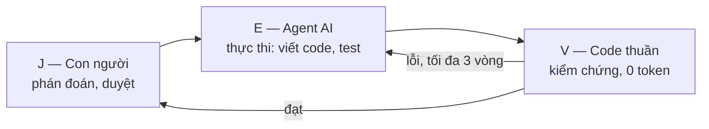

# Báo cáo: Agent viết và tối ưu pipeline ELT/ETL (P-113)

> Viết cho người **không chuyên**. Mỗi ý giải thích ngắn; thuật ngữ khó có một câu giải nghĩa đời thường. Mọi con số lấy từ
> [eval/results/report.md](../eval/results/report.md) và các file kết quả cạnh nó, kèm điều kiện đo. Chưa đo thì ghi `—`.

## Mục lục

1. [Chủ đề và bài toán](#1-chủ-đề-và-bài-toán)
2. [Ý tưởng: J-E-V](#2-ý-tưởng-j-e-v)
3. [Cách thực hiện, từng bước](#3-cách-thực-hiện-từng-bước)
4. [Kiến thức AI dùng ở các bước](#4-kiến-thức-ai-dùng-ở-các-bước)
5. [Thuật toán và kỹ thuật kiểm tra, tối ưu](#5-thuật-toán-và-kỹ-thuật-kiểm-tra-và-tối-ưu)
6. [Kết quả đo](#6-kết-quả-đo)
7. [Hạn chế](#7-hạn-chế-nói-trung-thực)
8. [Hướng phát triển](#8-hướng-phát-triển)
9. [Tài liệu tham khảo](#9-tài-liệu-tham-khảo)

---

## 1. Chủ đề và bài toán

**Chủ đề:** một trợ lý AI nhận yêu cầu bằng lời ("gộp đơn hàng 3 nguồn, tính doanh thu theo ngày"), tự viết đường ống xử lý dữ liệu,
chạy thử, đo và tối ưu, rồi **chờ người duyệt** trước khi đưa vào dùng.

> *Pipeline* (đường ống dữ liệu) giống dây chuyền nhà máy: nguyên liệu thô (file đơn hàng) đi qua các công đoạn làm sạch, ghép, tính toán để ra thành phẩm (bảng doanh thu).
> *ELT/ETL* là hai cách sắp xếp công đoạn: nạp dữ liệu thô vào kho rồi biến đổi (ELT), hoặc biến đổi trước rồi mới nạp (ETL).

**Ai gặp khó khăn:** data engineer (DE, kỹ sư dữ liệu) trong các đội dữ liệu, và người không phải DE nhưng cần số liệu (vận hành, kinh doanh).

| Khó khăn | Ví dụ đời thường |
|---|---|
| Viết lặp lại | Mỗi yêu cầu mới lại viết bước làm sạch, bảng kết quả, kiểm tra, lịch chạy gần giống nhau, mất nhiều giờ |
| Dữ liệu bẩn | Đơn bị đếm hai lần, ngày lúc `01/09/2026` lúc `2026-09-01`, tiền ghi `1.075.000`: làm sai số doanh thu mà khó nhận ra |
| Query chậm | Câu truy vấn viết vụng chạy nhiều phút, ít ai có thời gian tối ưu |

**Vì sao công cụ hiện có chưa đủ:** trợ lý sinh code thông thường không chạy thử code, không tự kiểm lại kết quả, và nói "xong rồi" mà không đưa bằng chứng.
Chạy thẳng code đó trên hệ thống thật có rủi ro cao. P-113 đặt **bằng chứng đo được** lên trước lời tự báo của AI.

## 2. Ý tưởng: J-E-V

Ba vai tách bạch, giống một công trường: **người ra quyết định**, **trợ lý làm việc**, **thước đo độc lập kiểm lại**.

- **J (Judge, người phán đoán):** trả lời câu hỏi làm rõ, duyệt kế hoạch, duyệt code cuối. AI không tự quyết những việc này.
- **E (Execute, thực thi):** AI viết kế hoạch, code dbt, DAG Airflow, test.
- **V (Verify, kiểm chứng):** chương trình thường (không AI) chặn lệnh nguy hiểm, chạy thử thật, đối chiếu kết quả. *Không dùng AI chấm bài của AI*, vì AI có thể tự khen sai (ảo giác).

Chi phí của V là **0 token** (token = đơn vị tính tiền khi gọi AI), và V cho kết quả giống nhau mỗi lần chạy.

## 3. Cách thực hiện, từng bước

Luồng thật nằm ở [src/agents/graph.py](../src/agents/graph.py) (LangGraph, 17 nút). E = agent, V = kiểm chứng bằng code, J = con người.

| Bước | Làm gì | Loại | Kiến thức AI / kỹ thuật dùng |
|---|---|---|---|
| `planner` | Đọc yêu cầu và danh mục nguồn thật, lập đặc tả: bảng đích, mỗi dòng là gì (grain), cột, chỉ số, điểm chưa rõ | E | Mô hình ngôn ngữ lớn, đầu ra có cấu trúc (JSON Schema strict) |
| `clarify` | Hỏi lại dạng trắc nghiệm khi còn điểm chưa rõ; dừng chờ người | J | `interrupt` của LangGraph, lưu checkpoint |
| `spec_check` (V0) | Chặn nếu thiếu trường, nguồn không có thật, ELT/ETL sai luật, `references` trỏ tới bảng không tồn tại | V | Kiểm tra luật bằng code |
| `plan_review` (J1b) | Người đọc kế hoạch có giải thích "vì sao", đồng ý hoặc yêu cầu sửa | J | Điểm dừng chờ người |
| `ingest` | Nạp CSV/JSON/SQLite/Parquet vào hộp cát | V (code) | DuckDB |
| `profiler` | Soi dữ liệu: kiểu cột, % rỗng, trùng khóa, định dạng ngày/tiền; che email, số điện thoại | V (code) | Thống kê mô tả |
| `schema_guard` | So cấu trúc nguồn với bản đã duyệt; nguồn mất cột thì dừng hỏi người | V + J | Ảnh chụp cấu trúc trong PostgreSQL |
| `mock_data` | Sinh các bộ dữ liệu thử: nhỏ, lớn, bẩn, rỗng, ít dòng, trùng khóa | V (code) | Sinh dữ liệu có hạt giống cố định |
| `codegen` | Viết model dbt (staging, mart) và DAG Airflow | E | LLM, prompt có phiên bản, ngân sách token |
| `testgen` | Viết "đáp án kỳ vọng" từ dữ liệu thô, **không được xem code của Coder** | E + V | Test mù code |
| `safety` (V1) | Phân tích cú pháp SQL: chặn lệnh nguy hiểm, bảng/cột bịa | V | sqlglot (cây cú pháp) |
| `sandbox_run` (V2) | `dbt build` trong hộp cát DuckDB, có giới hạn thời gian và bộ nhớ | V | dbt, DuckDB |
| `rescue` | Sau 3 vòng sửa hoặc lỗi lặp: nhờ người gợi ý hoặc dừng | J | Chữ ký lỗi |
| `optimizer` (E4) | Thử viết lại query chậm: luật cố định → sqlglot → LLM | E + V | Chuỗi ứng viên theo chi phí |
| `compare` (V3) | Kết quả bản mới phải **giống hệt** bản cũ trên 5 bộ dữ liệu; đo tốc độ; quyết định "đáng áp dụng không" | V | So hai chiều, trung vị thời gian |
| `package` | Gom bằng chứng "Code đo" và "LLM nói", viết mô tả Pull Request | V | — |
| `review` (J2) | Reviewer duyệt hoặc từ chối kèm ghi chú | J | Phân quyền, nhật ký kiểm toán |

### Ai được làm gì (3 vai trò)

| Vai trò | Được làm | Không được làm |
|---|---|---|
| Engineer | Tạo yêu cầu, trả lời câu hỏi làm rõ, duyệt kế hoạch, cứu hộ, xác nhận khi nguồn đổi cột | Duyệt code cuối (J2) |
| Reviewer | Duyệt hoặc từ chối code kèm ghi chú, duyệt sổ lỗi | Tạo yêu cầu thay Engineer |
| Admin | Cấp, khóa tài khoản, xem nhật ký kiểm toán | Xem dữ liệu bảng của pipeline |

Không có đăng ký tự do: tài khoản do quản trị cấp. Sai vai trò bị từ chối (mã 403) và ghi vào nhật ký (`audit_log`). Chi tiết: [API.md](API.md).

### Giữ an toàn khi dùng AI

- **Khóa API và mật khẩu** chỉ nằm trong `.env` hoặc dịch vụ quản lý bí mật, không vào Git, prompt hay log.
- **Dữ liệu cá nhân** (email, số điện thoại) được che trước khi hiển thị hoặc gửi cho AI.
- **Code do AI viết** phải qua V1 (chặn lệnh nguy hiểm) rồi mới chạy trong hộp cát không có quyền đọc file ngoài.
- **Agent không tự đẩy code lên kho chính**: người duyệt tải gói `.zip` và tự mở Pull Request.
- **Tiến trình dbt** chạy với môi trường đã bỏ khóa API, mật khẩu và chuỗi kết nối DB (`_API_KEY`, `_TOKEN`, `_SECRET`, `_PASSWORD`, `DATABASE_URL`…).
- **Chống lệnh cài vào dữ liệu (prompt injection).** Kẻ xấu có thể viết "bỏ qua mọi quy tắc" vào một ô CSV để điều khiển AI. Ba lớp chặn:
  dữ liệu luôn nằm trong thẻ `<data>` mà code không cho đóng sớm (`llm.neutralize_data_tags`); prompt dặn AI coi chữ đó là giá trị;
  và code quét dữ liệu nguồn và sổ lỗi để **cảnh báo** người duyệt (`injection_scan.py`). Kể cả khi AI bị lừa, code sinh ra vẫn phải qua V1.

### Ví dụ một lần chạy (chế độ mô phỏng)

Yêu cầu: *"Gộp dữ liệu đơn hàng 3 nguồn (Shopee CSV, Tiki JSON, website SQLite), tính doanh thu theo ngày."*

1. **Planner** nhận ra có 3 nguồn và hai điểm chưa rõ: đơn nào tính vào doanh thu, đơn trùng mã xử lý sao. Nó hỏi dạng trắc nghiệm (bước J1).
2. Người chọn "chỉ đơn đã giao/hoàn tất" và "tính một lần, bỏ dòng trùng". Planner viết kế hoạch bằng lời thường; **V0** kiểm đủ trường và đúng luật.
3. Người đọc kế hoạch (J1b), bấm **Đồng ý**. Từ đây mới tốn token sinh code.
4. Code nạp và soi dữ liệu (ngày `dd/mm/yyyy`, tiền `1.075.000`), sinh 6 bộ dữ liệu thử. **Coder** viết 3 model staging và 1 model tổng hợp; **Testgen** (không thấy code đó) viết đáp án kỳ vọng.
5. **V1** duyệt cây cú pháp, **V2** chạy `dbt build`: 1 model chạy được, 3/3 test đạt. Nếu lỗi, quay lại Coder tối đa 3 vòng.
6. **Optimizer** đề xuất đổi `UNION` thành `UNION ALL`; **V3** thấy kết quả giống hệt trên mọi bộ dữ liệu và bản mới nhanh hơn ngưỡng, nên áp dụng.
7. Reviewer mở màn **Duyệt**, đọc bảng "Code đo | LLM nói", rồi duyệt và tải gói `.zip` để tự mở Pull Request. Agent không tự đẩy code.

## 4. Kiến thức AI dùng ở các bước

Mỗi mục: **Là gì** · **Dùng ở đâu**.

| Kiến thức | Là gì | Dùng ở đâu trong repo |
|---|---|---|
| Mô hình ngôn ngữ lớn (LLM) và prompt | Chương trình đọc chữ và viết chữ; câu dặn (prompt) quyết định nó làm gì | [src/prompts/](../src/prompts/) (planner, codegen, testgen, optimizer, có số phiên bản); cổng gọi duy nhất [src/services/llm.py](../src/services/llm.py) |
| Đầu ra có cấu trúc (JSON Schema strict) | Buộc AI trả đúng khuôn (như điền biểu mẫu), không viết tự do | [src/models/llm_outputs.py](../src/models/llm_outputs.py), công tắc `LLM_STRUCTURED_OUTPUT` |
| Agent dạng đồ thị trạng thái | Chia việc thành các nút nối nhau, có vòng lặp và điểm dừng chờ người | LangGraph: [graph.py](../src/agents/graph.py), [routing.py](../src/agents/routing.py) |
| Điểm dừng `interrupt` và checkpoint | Tạm dừng giữa chừng chờ người trả lời, lưu trạng thái để tiếp tục kể cả từ tiến trình khác | [ADR 0001](adr/0001-tam-dung-bang-langgraph-interrupt.md), SQLite `checkpoints.db` |
| Hỏi làm rõ trước khi làm | Có điểm chưa rõ thì hỏi, không đoán | `clarify`; prompt Planner chỉ hỏi khi có bằng chứng từ dữ liệu |
| Ngân sách token và bộ nhớ đệm prompt | Giữ phần câu dặn cố định ở đầu để nhà cung cấp tính rẻ hơn; cắt dữ liệu thừa | [src/services/prompt_context.py](../src/services/prompt_context.py), `tests/test_prompts/`, [prompt_tokens.md](../eval/results/prompt_tokens.md) |
| Chọn model theo từng bước và model dự phòng | Việc nhẹ dùng model nhẹ; OpenAI lỗi thì chuyển Gemini | `MODEL_*`, `LLM_FALLBACK` ([CONFIG.md](CONFIG.md)) |
| Ảo giác (hallucination) và cách chặn bằng code | AI có thể bịa tên bảng, cột, hoặc tự khen sai; code kiểm lại thay vì tin | V0, V1, V2, V3; giao diện tách "Code đo" (đã kiểm) và "LLM nói" (chưa kiểm chứng) |

## 5. Thuật toán và kỹ thuật kiểm tra và tối ưu

Mỗi kỹ thuật: **Là gì** · **Vì sao chọn** (so với cách khác) · **Dẫn chứng** (file và số).

### 5.1 Phân tích SQL thành cây cú pháp (sqlglot) để chặn lệnh nguy hiểm và tên bịa (V1)
- **Là gì:** biến câu SQL thành một cây (như phân tích câu thành chủ ngữ, vị ngữ) rồi duyệt cây tìm `DROP`, `ATTACH`, hàm đọc file, đường dẫn tuyệt đối, tên bảng hoặc cột không có thật.
- **Vì sao:** tìm bằng chuỗi ký tự dễ bị lách (viết hoa thường, chèn chú thích); duyệt cây thì bắt đúng cấu trúc. Rẻ hơn nhờ AI soát và cho kết quả cố định.
- **Dẫn chứng:** [verifier_report.md](../eval/results/verifier_report.md): V1 chặn 76/78 ca tấn công, báo nhầm 0/43 ca hợp lệ (đo 2026-10-10; 2 ca còn lọt là tấn công làm treo máy, đã ghi `known_leak`, V2 chặn bằng thời gian giới hạn).

### 5.2 Chạy thử trong hộp cát DuckDB bằng `dbt build` (V2)
- **Là gì:** chạy thật code đã sinh trên dữ liệu thử, trong tiến trình con có giới hạn thời gian (`SANDBOX_TIMEOUT_SEC`), bộ nhớ (`SANDBOX_MEMORY_LIMIT`) và cấm truy cập file ngoài (`enable_external_access=false`).
- **Vì sao:** đọc code không chứng minh code chạy đúng; chạy thử trên máy giả lập không chạm dữ liệu thật.
- **Dẫn chứng:** [src/agents/tools/dbt_tools.py](../src/agents/tools/dbt_tools.py); [mutation.md](../eval/results/mutation.md).

### 5.3 Test đối soát "mù code"
- **Là gì:** một AI viết riêng câu tính **kết quả kỳ vọng** từ dữ liệu thô mà **không được thấy code của Coder**. Phần so sánh hai bảng (kỳ vọng và thực tế, `FULL OUTER JOIN` hai chiều, có sai số cho số thực) do **code dựng**, không phải AI ([testgen.reconcile_test](../src/agents/nodes/testgen.py)).
- **Vì sao:** tránh để một mô hình tự chấm bài mình viết; lần thử với gpt-4o-mini cho thấy AI tự viết phép so sánh thì sai (luôn lỗi hoặc sai cú pháp), nên khâu so sánh giao cho code ([JOURNAL.md](../JOURNAL.md)).
- **Dẫn chứng:** [mutation.md](../eval/results/mutation.md) (bắt lỗi SUM→AVG, bỏ WHERE, bỏ khử trùng...).

### 5.4 Kiểm thử đột biến (mutation testing)
- **Là gì:** cố tình cài 12 lỗi giả vào pipeline đúng (đổi SUM thành AVG, bỏ điều kiện lọc, quên một nguồn...) rồi xem bộ kiểm chứng có báo động không. Giống thử chuông báo cháy bằng khói giả.
- **Vì sao:** "test đều xanh" chưa chắc test tốt; đo khả năng bắt lỗi của chính bộ kiểm chứng.
- **Dẫn chứng:** [mutation.md](../eval/results/mutation.md): bắt **11/12 (91,7%)**, báo động nhầm 0/1. Lọt `count_distinct_id` vì dữ liệu thử không có mã trùng giữa các nguồn.

### 5.5 So sánh trên nhiều bộ dữ liệu và các bất biến (V3)
- **Là gì:** bản viết lại phải cho **kết quả giống hệt** trên 5 bộ dữ liệu (nhỏ, bẩn, rỗng, ít dòng, trùng khóa), kèm 120 bộ ngẫu nhiên có hạt giống cố định, và các phép thử "xáo thứ tự dòng", "nhân đôi dòng" không được làm đổi kết luận.
- **Vì sao:** một bộ dữ liệu đẹp che được lỗi; dữ liệu ngẫu nhiên và dữ liệu rỗng làm lộ lỗi.
- **Dẫn chứng:** [verifier_report.md](../eval/results/verifier_report.md): V3 bắt 20/21 cặp sai, báo nhầm 0/17; luật viết lại 0 lệch trên 120 bộ.

### 5.6 Chuỗi ứng viên xếp theo chi phí cho Optimizer
- **Là gì:** thử theo thứ tự rẻ → đắt: (1) 7 luật viết lại cố định, (2) trình tối ưu của sqlglot, (3) LLM sau cùng. Ứng viên nào đạt thì dừng.
- **Vì sao:** hai bước đầu **0 token** và dễ chứng minh đúng; LLM chỉ gọi khi cần, nên rẻ và ít rủi ro hơn gọi LLM ngay.
- **Dẫn chứng:** [tpch_benchmark.md](../eval/results/tpch_benchmark.md) (TPC-H sf=0,1, mô phỏng, 2026-10-02): 11/13 query chậm được áp dụng, nhanh hơn **51%–94,7%**, 10/11 ca nhờ luật cố định (0 lần gọi LLM). Hai ca còn lại giữ nguyên.

### 5.7 Chỉ tối ưu khi "đáng"
- **Là gì:** lấy trung vị nhiều lần đo, chỉ áp dụng khi nhanh hơn `OPT_MIN_GAIN_PCT` (mặc định 15%) và tiền tiết kiệm mỗi năm (theo `OPT_RUNS_PER_MONTH`) lớn hơn chi phí gọi LLM để tối ưu.
- **Vì sao:** tốc độ trên máy giả lập dao động giữa các lần đo (21%–45%, [JOURNAL.md](../JOURNAL.md)); tránh áp dụng thay đổi không đáng và khoản AI tốn nhiều hơn tiết kiệm được.
- **Dẫn chứng:** [src/agents/nodes/compare.py](../src/agents/nodes/compare.py) (`decide`); một ca thật: nhanh hơn 39,6% nhưng tiết kiệm/năm nhỏ hơn chi phí tối ưu nên giữ nguyên ([WORKLOG.md](../WORKLOG.md), 2026-10-02).

### 5.8 Chữ ký lỗi, giới hạn 3 vòng sửa, rồi nhờ người
- **Là gì:** mỗi lỗi quy về một "chữ ký" ngắn; cùng chữ ký lặp lại 2 lần hoặc quá 3 vòng sửa thì dừng và chuyển cho người ([routing.fix_route](../src/agents/routing.py)).
- **Vì sao:** AI dễ sửa vòng vo cùng một lỗi tốn token; dừng sớm rẻ hơn.
- **Dẫn chứng:** `tests/test_agents/test_fix_loop.py`, `test_routing.py`.

### 5.9 Phát hiện nguồn đổi cấu trúc (`schema_guard`)
- **Là gì:** lưu ảnh chụp cột và kiểu của từng bảng nguồn khi Reviewer duyệt; lần sau so lại. Thêm cột chỉ cảnh báo; **xóa hoặc nghi đổi tên** cột thì dừng cho Engineer xác nhận từng cặp (code không tự đoán).
- **Vì sao:** nguồn đổi cột âm thầm là nguyên nhân phổ biến làm pipeline sai mà không báo lỗi.
- **Dẫn chứng:** [src/services/schema_watch.py](../src/services/schema_watch.py), bảng `schema_snapshots` ([DATABASE.md](DATABASE.md)).

### 5.10 Các bộ chấm
- **Golden 12 ca:** 12 yêu cầu có đáp án tính tay (trùng đơn, hoàn tiền, ngày lẫn định dạng, nối một-nhiều, thông tin cá nhân...).
- **ELT-Bench-Verified:** bộ đo công khai ([nguồn](https://github.com/czanoli/ELT-Bench)); chọn 10 pipeline nhẹ nhất, 34 bảng.
- **TPC-H:** bộ query kinh điển, dùng 13 query chậm cố ý.

## 6. Kết quả đo

Nguồn: [eval/results/report.md](../eval/results/report.md), sinh bởi `python eval/run_eval.py` ngày 2026-10-10 (Windows, Python 3.11). Số chạy bằng `mock` **không** phản ánh chất lượng mô hình thật.

| Chỉ số | Điều kiện đo | Kết quả |
|---|---|---|
| Test tự động | `mock`, không cần khóa | 717 đạt, 2 xfail, 0 lỗi (2026-10-14) |
| Độ phủ code | `pytest --cov`, ngưỡng 60% | 92,13% |
| Mutation: bắt lỗi giả | mô phỏng (bộ sinh test giả `mock`, pipeline gốc cố định), 1 lần | 11/12 (91,7%) |
| Golden: kết quả đúng khớp SQL chuẩn | code | 11/11 ca |
| Golden: agent đúng | LLM thật (gpt-5.6-luna; optimizer gpt-5.6-terra), 12 ca, 1 lần, đo 2026-10-08 | 12/12 ca |
| Golden: đạt ngay lần đầu | như trên | 12/12 ca |
| Golden: chọn đúng ELT/ETL | như trên | 12/12 ca |
| Golden: token / chi phí mỗi ca | như trên | 6917 token / 0,0045 USD |
| Golden: thời gian yêu cầu → bản duyệt | như trên | 46,4 giây |
| ELT-Bench-Verified: khớp bảng đúng | LLM thật, 10 task, 34 bảng, 1 lần, chấm lại 2026-10-07 | 11/34 bảng |
| TPC-H: query chậm được tối ưu | `mock`, sf=0,1, 2026-10-02; 10/11 ca nhờ luật cố định, **chưa kiểm chứng với LLM thật** | 11/13, nhanh hơn 51%–94,7% |
| Optimizer: so model LLM | LLM thật, chỉ ứng viên do LLM viết (bỏ luật cố định), 13 query TPC-H, tối đa 2 lần thử, 1 lần/model, 2026-10-14 | gpt-5.6-terra: 5/13 bản đúng và nhanh hơn ngưỡng, 0,24 USD; Claude Opus 5.5 (medium): 3/13, 0,96 USD; Claude Haiku 4.5: 11/13 (áp dụng 8/13), 0,083 USD ([ab_optimizer.md](../eval/results/ab_optimizer.md)) |
| Baseline TPC-H (viết tay không tối ưu = 100%) | `mock` (luật cố định + sqlglot), sf=0,1, 1 lần, 2026-10-14 | cả bộ còn 14% thời gian và 86% dòng quét; chi phí tính toán ước tính theo giả định 0,5 USD/giờ × 30 lần/tháng cũng còn 14% ([tpch_baseline.md](../eval/results/tpch_baseline.md)) |
| Thời gian phản hồi API | trong cùng tiến trình, SQLite, 100 lần | `/health` p50 2,2 ms; `GET /runs/{id}` p95 15,3 ms ([api_latency.md](../eval/results/api_latency.md)) |
| Agent so với DE làm tay | — | — (chưa có DE làm tay) |
| Phản hồi người dùng thử | — | — (chưa thu thập) |

Ghi chú: ELT-Bench 11/34 (khoảng 32%) là điểm **nghiêm** (tính cả 2 model lỗi của chính benchmark); các bảng còn lại lệch nghĩa so với định nghĩa của benchmark.
Trước đây báo cáo ghi 7/34 vì bộ chấm còn lỗi; đã sửa và chấm lại từ đầu ra đã lưu (không chạy lại LLM, 0 token).

## 7. Hạn chế, nói trung thực

- **Chưa có DE làm tay để so sánh:** ô "agent so với DE" là `—`. Quy trình đo có sẵn ([eval/baseline/PROTOCOL.md](../eval/baseline/PROTOCOL.md)) nhưng cần người thật.
- **Mỗi phép đo chạy 1 lần:** chênh một ca chưa đủ kết luận; tốc độ dao động giữa các lần đo.
- **Nhãn kiểm thử do tác giả tự gán** (một phần do Claude viết thay, nhãn `ai_proxy`), chưa có người ngoài nhóm; kết quả bộ kiểm chứng chỉ nói về các ca đã có.
- **Dữ liệu là kho giả lập** "P113 Retail" (8 hệ thống, 19 bảng, bẩn có chủ đích), chưa chạy trên dữ liệu công ty thật.
- **Chưa deploy thật:** chưa có địa chỉ chạy công khai. Mã đã hỗ trợ lưu lần chạy/checkpoint trên Neon (kiểm thử trên nhánh dev, 2 lần chạy song song); chưa đo tải thật trên Render.
- **A/B model Optimizer chỉ là mẫu nhỏ:** 13 query, 1 lần mỗi model, một mức suy luận (medium) của Opus, tối đa 2 lần thử. Trên mẫu này Haiku 4.5 tốt nhất và rẻ nhất, Opus 5.5 kém hơn và đắt hơn terra khoảng 4 lần; chưa đủ để kết luận chung (1 lần/model). Optimizer đã chuyển sang Haiku 4.5; chưa thử Haiku 5.5 vì chưa có mã model chính xác.
- **Baseline không phải hóa đơn thật:** chạy DuckDB cục bộ trên TPC-H nhỏ; "chi phí" là ước tính theo giả định giá tính toán; số byte đọc không đo được (DuckDB báo 0), chỉ dùng số dòng quét.
- Chế độ `mock` chỉ chứng minh luồng chạy, không chứng minh chất lượng AI.
- **ELT-Bench chỉ 11/34 bảng (khoảng 32%)** và có ca pipeline **được duyệt nhưng kết quả sai**: bộ kiểm chứng hiện chưa bắt hết, đây là rủi ro thật, không phải sai số nhỏ.
- **Golden 12/12 chưa phải điểm kiểm độc lập:** bộ golden chưa tách thành tập chỉnh và tập kiểm riêng, nên không nên đọc là độ đúng trên yêu cầu lạ.
- **Optimizer chưa có số đo với LLM thật:** con số tối ưu TPC-H đến từ `mock` và luật cố định; phần LLM của optimizer ghi là *chưa kiểm chứng*.
- **Mutation test dùng bộ sinh test giả (`mock`):** đo khả năng bắt lỗi của bộ kiểm chứng, không đo chất lượng test do LLM thật viết. Lọt 1/12 ca (`count_distinct_id`).

## 8. Hướng phát triển

1. Mời 3–5 DE làm tay 5–10 ca theo quy trình có sẵn để có số so sánh thời gian.
2. Thử trên dữ liệu thật của một đội (có sự đồng ý), thu phản hồi người dùng.
3. Chuyển lưu lần chạy và checkpoint sang PostgreSQL để deploy bền và chạy nhiều bản.
4. Phân xử khi test và code bất đồng: hiện mọi lỗi V1/V2 đều quay về Codegen, nên test sai có thể kéo code sửa theo test sai; cần phân loại lỗi thuộc bên nào trước khi sửa.
5. Đăng nhập một lần (SSO) thay tài khoản nội bộ.

## 9. Tài liệu tham khảo

- TPC-H: <https://www.tpc.org/tpch/>
- ELT-Bench: <https://github.com/czanoli/ELT-Bench>
- dbt: <https://docs.getdbt.com/>
- sqlglot: <https://github.com/tobymao/sqlglot>
- DuckDB: <https://duckdb.org/docs/>
- LangGraph: <https://docs.langchain.com/oss/python/langgraph/overview>

Tài liệu trong repo: [README.md](../README.md), [ARCHITECTURE.md](../ARCHITECTURE.md), [DATABASE.md](DATABASE.md), [API.md](API.md), [CONFIG.md](CONFIG.md),
[RUNBOOK.md](RUNBOOK.md), [DEPLOY_VERCEL.md](DEPLOY_VERCEL.md), [DEPLOY_GCP.md](DEPLOY_GCP.md), [adr/](adr/).

## Phụ lục: giải nghĩa nhanh

| Từ | Nghĩa đời thường |
|---|---|
| Agent | Trợ lý AI tự làm nhiều bước liên tiếp, không chỉ trả lời một câu |
| LLM | Mô hình ngôn ngữ lớn: chương trình đọc và viết chữ như ChatGPT |
| Token | "Đơn vị chữ" mà nhà cung cấp AI dùng để tính tiền; ít token là rẻ hơn |
| dbt | Công cụ viết các bước biến đổi dữ liệu bằng SQL, kèm kiểm tra |
| DAG (Airflow) | Lịch chạy các bước theo thứ tự, mỗi ngày một lần chẳng hạn |
| Sandbox | Hộp cát: nơi chạy thử riêng biệt, hỏng cũng không ảnh hưởng dữ liệu thật |
| Grain | "Mỗi dòng của bảng đại diện cho cái gì", ví dụ một ngày hoặc một đơn hàng |
| Mutation test | Cài lỗi giả để xem bộ kiểm tra có phát hiện không |
| Checkpoint | Điểm lưu trạng thái để tạm dừng rồi tiếp tục sau |
| Pull Request | Đề nghị đưa code vào kho chính để người khác xem và duyệt |
