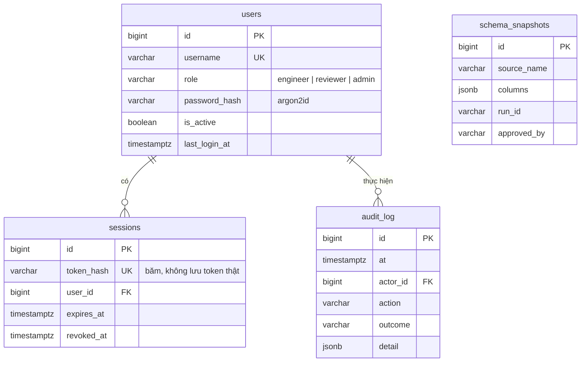

# Cơ sở dữ liệu của P-113

Hướng dẫn cho người mới: dữ liệu nằm ở đâu, cách xem, cách dựng từ đầu trong ~10 phút, sao lưu và khôi phục.
Các lệnh dưới đây đã chạy thật trên máy tác giả (Windows, Docker Desktop, PostgreSQL 17) ngày 2026-10-10.

## 1. Dữ liệu nằm ở đâu

| Nơi lưu | Chứa gì | Cấu hình |
|---|---|---|
| **PostgreSQL 17** (`p113_dev`) | Tài khoản, phiên đăng nhập, nhật ký kiểm toán, ảnh chụp cấu trúc nguồn | `DATABASE_URL`, `MIGRATION_DATABASE_URL` |
| **PostgreSQL** (khi `STATE_BACKEND=postgres`, triển khai thật) | Thêm: `runs`, `reviews`, `error_entries`, `memory_items` (bộ nhớ agent) và bảng checkpoint LangGraph; tạo bởi migration 0003, 0004 | `DATABASE_URL` |
| **SQLite** `data/app.db` (khi `STATE_BACKEND=sqlite`, mặc định, demo/test) | Các lần chạy (`runs`), quyết định duyệt (`reviews`), sổ lỗi (`error_entries`), `memory_items` | `STORE_PATH` |
| **SQLite** `data/checkpoints.db` (như trên) | Trạng thái graph LangGraph để tạm dừng/tiếp tục (J1, J1b, J2) | `CHECKPOINT_PATH` |
| **DuckDB** `pipelines/workspaces/<run_id>/sandbox.duckdb` | Sandbox chạy thử `dbt build` của từng lần chạy; không phải dữ liệu thật | `WORKSPACES_DIR` |
| **Thư mục** `data/sources/` | Kho nguồn giả lập "P113 Retail" (CSV, JSON, SQLite, Parquet) | `SOURCES_DIR` |

> Giải thích đời thường: PostgreSQL giống sổ đăng ký của tòa nhà (ai được vào, ai vào lúc nào). SQLite là sổ ghi chép công việc nằm cạnh máy chủ.
> DuckDB là phòng thử nghiệm dùng một lần.

**Cập nhật (2026-10-14): triển khai thật chuyển lần chạy, sổ lỗi, bộ nhớ agent và checkpoint sang PostgreSQL/Neon (`STATE_BACKEND=postgres`, 2 luồng chạy song song `RUN_WORKERS=2`); SQLite vẫn là chế độ mặc định cho demo và test.** Đoạn dưới là quyết định cũ (2026-10-10), chỉ còn đúng với chế độ SQLite.

**Quyết định cũ (2026-10-10): giữ SQLite cho lần chạy và checkpoint.** Lý do: ít sửa nhất, đã được kiểm thử (613 test).
Hệ quả: backend chỉ nên chạy **một bản** và cần **ổ đĩa bền** (volume Docker, đĩa máy ảo). Cloud Run mặc định có hệ thống tệp tạm,
nên lần chạy đang dở có thể mất khi khởi động lại; xem [DEPLOY_GCP.md](DEPLOY_GCP.md). Chuyển sang PostgreSQL
(gói `langgraph-checkpoint-postgres`, viết lại `store.py`/`error_memory.py`) là việc lớn, nằm trong hướng phát triển.

## 2. Sơ đồ quan hệ bảng PostgreSQL



| Bảng | Mô tả một dòng |
|---|---|
| `users` | Tài khoản nội bộ, mật khẩu băm argon2id, 3 vai trò (ràng buộc `ck_users_role`) |
| `sessions` | Phiên đăng nhập phía máy chủ; chỉ lưu băm của token, có hạn và có thể thu hồi |
| `audit_log` | Ai làm gì, lúc nào, kết quả; chỉ ghi thêm, `actor_id` có thể trống (đăng nhập sai) |
| `schema_snapshots` | Ảnh chụp cấu trúc bảng nguồn đã được Reviewer duyệt, để phát hiện nguồn đổi cột; chỉ ghi thêm |
| `alembic_version` | Phiên bản migration hiện tại (`0002_schema_snapshots`) |

Hai tài khoản PostgreSQL (tạo bởi [scripts/postgres-init.sql](../scripts/postgres-init.sql)):
`p113_migrator` (sở hữu bảng, chạy migration) và `p113_app` (ứng dụng dùng hằng ngày, không có quyền đổi cấu trúc).

## 3. Dựng từ đầu (~10 phút)

Cần: Docker Desktop, Python 3.11, repo đã clone.

```bash
# 1. Môi trường Python
python -m venv .venv && source .venv/bin/activate        # Windows: .\.venv\Scripts\Activate.ps1
pip install -r requirements.txt

# 2. Tạo .env và điền các biến (giá trị bí mật chỉ nằm trong .env, đã git-ignore)
cp .env.example .env                                     # Windows: Copy-Item .env.example .env
python -c "import secrets; print(secrets.token_urlsafe(48))"   # dán vào SESSION_SECRET
#   POSTGRES_PASSWORD, P113_MIGRATOR_PASSWORD, P113_APP_PASSWORD: tự đặt mật khẩu mạnh
#   DATABASE_URL           = postgresql+psycopg://p113_app:<P113_APP_PASSWORD>@127.0.0.1:5433/p113_dev
#   MIGRATION_DATABASE_URL = postgresql+psycopg://p113_migrator:<P113_MIGRATOR_PASSWORD>@127.0.0.1:5433/p113_dev
#   (dùng 127.0.0.1, không dùng "localhost": Windows thử IPv6 trước và bị treo)

# 3. Bật PostgreSQL, chạy migration
docker compose up -d db
alembic upgrade head                                     # kết quả mong đợi: không lỗi
alembic current                                          # → 0002_schema_snapshots (head)

# 4. Tạo tài khoản quản trị đầu tiên (mật khẩu nhập ẩn, không in ra, tối thiểu 12 ký tự)
python -m src.cli users create --username quantri --name "Quản trị" --role admin
python -m src.cli users list

# 5. Chạy web và đăng nhập
python scripts/tasks.py run                              # API http://localhost:8000
cd frontend && npm ci && npm run dev                     # web http://localhost:3000
```

Chỉ để thử trên máy mình: `python -m src.cli users seed-dev` tạo ba tài khoản mẫu `an` / `binh` / `quantri`,
mật khẩu ngẫu nhiên **in một lần** (không chạy được khi `APP_ENV=production`).

Không muốn bật Docker: dùng PostgreSQL trên Neon (branch `dev`), xem [NEON.md](NEON.md).

Cách khác chạy migration bằng Docker (tài khoản migration, không cần cài Python): `docker compose --profile tools run --rm migrate`.

## 4. Cách xem dữ liệu

```bash
docker compose exec db psql -U postgres -d p113_dev
```
```sql
\dt                                   -- liệt kê bảng
\d users                              -- cấu trúc một bảng
SELECT username, role, is_active, last_login_at FROM users;
SELECT at, actor_name, action, outcome FROM audit_log ORDER BY at DESC LIMIT 10;
```

**DBeaver / pgAdmin:** Host `127.0.0.1`, Port `5433`, Database `p113_dev`, User `p113_app` (chỉ đọc/ghi dữ liệu)
hoặc `p113_migrator` (xem cả cấu trúc), mật khẩu lấy trong `.env`. Cổng chỉ mở cho máy bạn (`127.0.0.1`), không ra mạng.

SQLite: `sqlite3 data/app.db ".tables"` rồi `SELECT id, status, requester FROM runs ORDER BY created_at DESC LIMIT 10;`
(mở bằng "DB Browser for SQLite" cũng được; đóng API trước khi sửa tay).

## 5. Migration, quay lui, sao lưu

```bash
alembic upgrade head          # lên bản mới nhất
alembic downgrade -1          # lùi một bước (0002 → 0001): bảng schema_snapshots bị xóa cùng dữ liệu trong đó
alembic upgrade head          # lên lại
```
Đã thử `downgrade -1` rồi `upgrade head` trên cơ sở dữ liệu test `p113_test`: cả hai đều đạt.
**Không** chạy `downgrade` trên cơ sở dữ liệu có dữ liệu thật mà chưa sao lưu.

```bash
# Sao lưu (định dạng nén của pg_dump), chạy trong container
docker compose exec db pg_dump -U postgres -d p113_dev -Fc -f /tmp/p113.dump
docker compose cp db:/tmp/p113.dump ./p113.dump          # lấy file ra máy

# Khôi phục vào cơ sở dữ liệu trống
docker compose cp ./p113.dump db:/tmp/p113.dump
docker compose exec db psql -U postgres -c "CREATE DATABASE p113_restore"
docker compose exec db pg_restore -U postgres -d p113_restore --no-owner /tmp/p113.dump
```
Đã thử sao lưu rồi khôi phục vào cơ sở dữ liệu tạm: bảng `users` khôi phục đủ 3 dòng. File sao lưu chứa băm mật khẩu: giữ bí mật.
Sao lưu SQLite: sao chép `data/app.db` khi API đã dừng (hoặc `sqlite3 data/app.db ".backup 'app.bak'"`).

## 6. Chạy test với PostgreSQL thật

Test mặc định dùng SQLite tạm. Muốn chạy với PostgreSQL: đặt `TEST_DATABASE_URL` (tài khoản migration, tên cơ sở dữ liệu **phải chứa "test"**)
trỏ tới `p113_test`, rồi `pytest tests/test_api/test_auth.py tests/test_services`. Kết quả ngày 2026-10-10: **100 passed**.
4 test từng bị bỏ qua trong CI không liên quan đến PostgreSQL: chúng cần tải bộ mã `tiktoken` từ mạng.

## 7. Khi triển khai thật

Chuỗi kết nối production thêm `?sslmode=verify-full`; mật khẩu đặt trong dịch vụ quản lý bí mật. Xem
[DEPLOY_VERCEL.md](DEPLOY_VERCEL.md) và [DEPLOY_GCP.md](DEPLOY_GCP.md). Biến môi trường: [CONFIG.md](CONFIG.md).

## Bộ nhớ agent (`memory_items`)

- **Ghi:** khi một lần chạy tự sửa lỗi thành công và tới bước chờ duyệt, agent đề xuất tối đa 3 mục loại `error_fix` (mô tả lỗi đã che số liệu + số lần sửa). Mục luôn ở trạng thái `pending` và được quét mẫu lệnh độc hại.
- **Duyệt:** Reviewer duyệt hoặc bỏ ở trang Sổ lỗi (API `/memory`, có ghi nhật ký kiểm toán).
- **Đọc:** planner và codegen chỉ nhận tối đa 3 mục `approved` của đúng tài khoản tạo yêu cầu, gửi trong khối `account_memory` của prompt. Không đọc được bộ nhớ của tài khoản khác.
- **Chưa làm:** loại `pipeline_pattern`, `preference`, `chat_summary`; mục chưa lưu nội dung cách sửa (chỉ ghi lỗi từng gặp và đã sửa được); `pgvector`.
