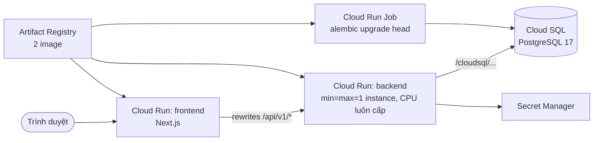

# Deploy: Google Cloud (Cloud Run + Cloud SQL + Secret Manager)

> **Trạng thái: tài liệu, chưa chạy thật.** Máy tác giả chưa cài `gcloud`, nên mọi lệnh `gcloud` bên dưới *(chưa chạy thật)*:
> chúng được đối chiếu với tài liệu chính thức của Google Cloud ngày 2026-10-10 (cờ lệnh `gcloud run deploy`, `gcloud sql instances create`,
> `gcloud run jobs create`). Phần chạy được trên máy (build 2 image Docker, `alembic`) đã chạy thật.
> Chi phí thay đổi: **kiểm tra lại trang giá của Cloud Run, Cloud SQL, Artifact Registry, Secret Manager** và đặt cảnh báo ngân sách trước khi tạo.

## 1. Sơ đồ



## 2. Chuẩn bị

| Việc | Ghi chú |
|---|---|
| Tài khoản Google Cloud có **billing** | Tạo một project riêng cho bài này để dễ xóa |
| Cài `gcloud` và đăng nhập | `gcloud auth login` rồi `gcloud config set project <PROJECT_ID>` |
| Docker (tùy chọn) | Dùng Cloud Build thì không cần build trên máy |
| Chi phí tham khảo | Cloud SQL tính theo giờ chạy kể cả khi rảnh, và backend `min-instances=1` luôn tính tiền: đây là hai khoản chính. Tra bảng giá hiện hành |

Biến dùng xuyên suốt (bash; PowerShell dùng `$env:` tương ứng):

```bash
export PROJECT_ID=<PROJECT_ID> REGION=asia-southeast1 REPO=p113 SQL_INSTANCE=p113-pg
export IMAGE_BE=$REGION-docker.pkg.dev/$PROJECT_ID/$REPO/backend IMAGE_FE=$REGION-docker.pkg.dev/$PROJECT_ID/$REPO/frontend
```

## 3. Các bước

### Bước 1. Bật API *(chưa chạy thật)*
```bash
gcloud services enable run.googleapis.com sqladmin.googleapis.com secretmanager.googleapis.com \
  artifactregistry.googleapis.com cloudbuild.googleapis.com
```
*Kết quả mong đợi:* `Operation ... finished successfully`.

### Bước 2. Artifact Registry *(chưa chạy thật)*
```bash
gcloud artifacts repositories create $REPO --repository-format=docker --location=$REGION
```

### Bước 3. Cloud SQL PostgreSQL 17 và hai tài khoản *(chưa chạy thật)*
```bash
gcloud sql instances create $SQL_INSTANCE --database-version=POSTGRES_17 --region=$REGION \
  --edition=ENTERPRISE --cpu=1 --memory=3840MiB
gcloud sql databases create p113_dev --instance=$SQL_INSTANCE
gcloud sql users create p113_migrator --instance=$SQL_INSTANCE --password='<MAT_KHAU_MIGRATOR>'
gcloud sql users create p113_app      --instance=$SQL_INSTANCE --password='<MAT_KHAU_APP>'
```
Hai tài khoản này do Cloud SQL tạo, **chưa có quyền như** [scripts/postgres-init.sql](../scripts/postgres-init.sql). Đăng nhập bằng tài khoản `postgres`
(đặt mật khẩu: `gcloud sql users set-password postgres --instance=$SQL_INSTANCE --password='<...>'`) qua Cloud SQL Studio trong Console, rồi chạy:
```sql
ALTER DATABASE p113_dev OWNER TO p113_migrator;
\c p113_dev
ALTER SCHEMA public OWNER TO p113_migrator;
GRANT USAGE ON SCHEMA public TO p113_app;
```
(Migration sẽ tự cấp quyền bảng cho `p113_app`.) Tên kết nối: `gcloud sql instances describe $SQL_INSTANCE --format='value(connectionName)'` → `<PROJECT>:<REGION>:<INSTANCE>`.

### Bước 4. Secret Manager *(chưa chạy thật)*
Cloud Run nối Cloud SQL qua ổ cắm Unix, nên chuỗi kết nối có dạng:
`postgresql+psycopg://p113_app:<MAT_KHAU_APP>@/p113_dev?host=/cloudsql/<PROJECT>:<REGION>:<INSTANCE>`
```bash
printf '%s' 'postgresql+psycopg://p113_app:<MAT_KHAU_APP>@/p113_dev?host=/cloudsql/<CONNECTION_NAME>'      | gcloud secrets create database-url --data-file=-
printf '%s' 'postgresql+psycopg://p113_migrator:<MAT_KHAU_MIGRATOR>@/p113_dev?host=/cloudsql/<CONNECTION_NAME>' | gcloud secrets create migration-database-url --data-file=-
python -c "import secrets; print(secrets.token_urlsafe(48))" | tr -d '\n' | gcloud secrets create session-secret --data-file=-
printf '%s' '<OPENAI_API_KEY>' | gcloud secrets create openai-api-key --data-file=-     # bỏ qua nếu dùng mock
```
Cấp quyền đọc cho tài khoản dịch vụ của Cloud Run (mặc định là tài khoản Compute của project):
```bash
SA=$(gcloud projects describe $PROJECT_ID --format='value(projectNumber)')-compute@developer.gserviceaccount.com
for s in database-url migration-database-url session-secret openai-api-key; do
  gcloud secrets add-iam-policy-binding $s --member=serviceAccount:$SA --role=roles/secretmanager.secretAccessor
done
gcloud projects add-iam-policy-binding $PROJECT_ID --member=serviceAccount:$SA --role=roles/cloudsql.client
```

### Bước 5. Build image backend *(chưa chạy thật)*
```bash
gcloud builds submit --tag $IMAGE_BE .
```
*Kết quả mong đợi:* `STATUS: SUCCESS`. (Dockerfile backend đã build thành công trên máy tác giả ngày 2026-10-10.)

### Bước 6. Migration bằng Cloud Run Job *(chưa chạy thật)*
```bash
gcloud run jobs create p113-migrate --image $IMAGE_BE --region $REGION \
  --command alembic --args upgrade,head \
  --set-secrets MIGRATION_DATABASE_URL=migration-database-url:latest \
  --set-cloudsql-instances <CONNECTION_NAME> --max-retries 0
gcloud run jobs execute p113-migrate --region $REGION --wait
```
*Kết quả mong đợi:* lần thực thi `succeeded`; bảng `users`, `sessions`, `audit_log`, `schema_snapshots` xuất hiện.

### Bước 7. Deploy backend *(chưa chạy thật)*
```bash
gcloud run deploy p113-backend --image $IMAGE_BE --region $REGION --port 8000 \
  --min-instances=1 --max-instances=1 --no-cpu-throttling \
  --memory=2Gi --cpu=1 --timeout=900 \
  --add-cloudsql-instances <CONNECTION_NAME> \
  --set-secrets DATABASE_URL=database-url:latest,SESSION_SECRET=session-secret:latest,OPENAI_API_KEY=openai-api-key:latest \
  --set-env-vars APP_ENV=production,LLM_PROVIDER=mock,FORCE_HTTPS=true,FORWARDED_ALLOW_IPS=* \
  --allow-unauthenticated
```
Lý do từng thiết lập bắt buộc:

| Cờ | Vì sao |
|---|---|
| `--min-instances=1 --max-instances=1` | SQLite (lần chạy, checkpoint) và workspace nằm trên đĩa của **một** bản; nhiều bản thì mỗi bản thấy dữ liệu khác nhau. `min=1` còn tránh khởi động nguội giữa lúc đang chạy |
| `--no-cpu-throttling` | Agent chạy nền *sau khi* trả mã 202; mặc định Cloud Run chỉ cấp CPU khi đang xử lý yêu cầu nên agent sẽ đứng hình |
| `--memory=2Gi` | `dbt` + DuckDB (giới hạn sandbox 1 GB) cần 1–2 GiB; thiếu bộ nhớ thì tiến trình bị giết |
| `--timeout=900` | Một yêu cầu kéo dài (tải gói `.zip`, hồ sơ dữ liệu) không bị cắt sớm; agent nền không phụ thuộc giá trị này |
| `--add-cloudsql-instances` | Gắn ổ cắm `/cloudsql/<CONNECTION_NAME>` để nối Cloud SQL |
| `--set-secrets` | Lấy mật khẩu/khóa từ Secret Manager, không viết vào lệnh hay image |
| `FORWARDED_ALLOW_IPS=*` | Tin tiêu đề `X-Forwarded-Proto` của proxy Cloud Run để `FORCE_HTTPS` không chuyển hướng vô tận |

Lấy địa chỉ: `BACKEND_URL=$(gcloud run services describe p113-backend --region $REGION --format='value(status.url)')`.
*Kết quả mong đợi:* `curl $BACKEND_URL/health` trả `status: ok`, `database: ok`.

Tạo admin đầu tiên (mật khẩu nhập ẩn) bằng một job dùng cùng image, hoặc chạy ở máy bạn với `DATABASE_URL` trỏ Cloud SQL qua
[Cloud SQL Auth Proxy](https://docs.cloud.google.com/sql/docs/postgres/sql-proxy):
```bash
python -m src.cli users create --username quantri --name "Quản trị" --role admin
```

### Bước 8. Build và deploy frontend *(chưa chạy thật)*
`NEXT_PUBLIC_*` và `BACKEND_URL` bị "nướng" lúc build nên phải truyền bằng `--build-arg`, mà `gcloud builds submit --tag` không truyền được: dùng file cấu hình Cloud Build.
Tạo `cloudbuild-frontend.yaml` (không commit nếu có địa chỉ riêng):
```yaml
steps:
  - name: gcr.io/cloud-builders/docker
    args: ["build", "-t", "$_IMAGE", "--build-arg", "NEXT_PUBLIC_API_URL=/", "--build-arg", "BACKEND_URL=$_BACKEND_URL", "./frontend"]
images: ["$_IMAGE"]
```
```bash
gcloud builds submit --config cloudbuild-frontend.yaml --substitutions=_IMAGE=$IMAGE_FE,_BACKEND_URL=$BACKEND_URL .
gcloud run deploy p113-frontend --image $IMAGE_FE --region $REGION --port 3000 --allow-unauthenticated
```
Dùng proxy cùng miền (`NEXT_PUBLIC_API_URL=/`) vì `*.run.app` nằm trong danh sách hậu tố công khai: cookie của hai dịch vụ **không** dùng chung được.
Cách thay thế: `SESSION_COOKIE_SAMESITE=none` + `CORS_ORIGINS=<URL frontend>` (dễ vướng chặn cookie bên thứ ba).

### Bước 9. Cập nhật `CORS_ORIGINS` (chỉ khi không dùng proxy) *(chưa chạy thật)*
```bash
gcloud run services update p113-backend --region $REGION --update-env-vars CORS_ORIGINS=<URL_FRONTEND>
```

## 4. Biến môi trường của backend

| Biến | Lấy ở đâu | Bí mật |
|---|---|---|
| `DATABASE_URL` | Secret `database-url` | **có** |
| `MIGRATION_DATABASE_URL` | Secret `migration-database-url` (chỉ job migration) | **có** |
| `SESSION_SECRET` | Secret `session-secret` | **có** |
| `OPENAI_API_KEY` | Secret `openai-api-key` | **có** |
| `APP_ENV`, `LLM_PROVIDER`, `FORCE_HTTPS`, `FORWARDED_ALLOW_IPS` | `--set-env-vars` | không |

Đầy đủ: [CONFIG.md](CONFIG.md).

## 5. Rủi ro đã biết (theo quyết định giữ SQLite)

Hệ thống tệp của Cloud Run là **tạm**: khi bản duy nhất khởi động lại (cập nhật, sự cố, bảo trì), `data/app.db`, `checkpoints.db` và workspace **mất**.
Hậu quả: danh sách lần chạy và lần chạy đang dở mất; **đăng nhập vẫn còn** vì ở Cloud SQL. Chấp nhận được cho bản demo; không dùng cho dữ liệu cần giữ.
Muốn bền: chuyển store lần chạy và checkpoint sang PostgreSQL (việc lớn, xem [DATABASE.md](DATABASE.md)); khi đó bỏ được giới hạn một bản.

### Phương án phụ: một máy ảo Compute Engine *(chưa chạy thật)*
Đơn giản và có đĩa bền, giống môi trường local:
```bash
gcloud compute instances create p113-vm --zone=${REGION}-a --machine-type=e2-medium \
  --image-family=debian-12 --image-project=debian-cloud --boot-disk-size=30GB
gcloud compute ssh p113-vm --zone=${REGION}-a
# trong máy ảo: cài Docker, clone repo, tạo .env (xem DATABASE.md), rồi:
docker compose up -d --build
```
Mở cổng 80/443 bằng một reverse proxy (Caddy/nginx) có HTTPS; không mở cổng 5433 của PostgreSQL ra ngoài.

## 6. Kiểm tra sau deploy

| Kiểm tra | Cách | Kết quả mong đợi |
|---|---|---|
| Backend sống | `curl $BACKEND_URL/health` | `status: ok`, `database: ok` |
| Đăng nhập | Mở URL frontend, đăng nhập admin | Vào trang chủ Admin |
| Lần chạy mô phỏng | Tạo engineer, gửi một yêu cầu với `LLM_PROVIDER=mock` | Dừng ở câu hỏi làm rõ rồi tới bản duyệt |

## 7. Lỗi thường gặp

| Triệu chứng | Cách xử lý |
|---|---|
| Lần chạy đứng ở "đang chạy" mãi | Quên `--no-cpu-throttling`, hoặc bản bị khởi động lại giữa chừng |
| `Permission denied` khi đọc secret | Thiếu `roles/secretmanager.secretAccessor` cho tài khoản dịch vụ |
| `connection refused` tới Cloud SQL | Thiếu `--add-cloudsql-instances` hoặc `roles/cloudsql.client` |
| Backend chuyển hướng lặp | Thiếu `FORWARDED_ALLOW_IPS=*` khi `FORCE_HTTPS=true` |
| Đăng nhập xong bị đá ra | `NEXT_PUBLIC_API_URL`/`BACKEND_URL` sai lúc build frontend: build lại |
| Container bị giết, log "out of memory" | Tăng `--memory` |

## 8. Gỡ bỏ để không tốn tiền

Cách gọn nhất: xóa cả project (`gcloud projects delete $PROJECT_ID`). Hoặc xóa từng thứ:
```bash
gcloud run services delete p113-frontend --region $REGION
gcloud run services delete p113-backend --region $REGION
gcloud run jobs delete p113-migrate --region $REGION
gcloud sql instances delete $SQL_INSTANCE
gcloud artifacts repositories delete $REPO --location=$REGION
for s in database-url migration-database-url session-secret openai-api-key; do gcloud secrets delete $s; done
```
Cloud SQL là khoản tốn tiền nhất khi quên: kiểm tra `gcloud sql instances list` sau khi xóa.
