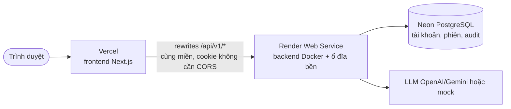

# Deploy: Vercel (web) + Render (backend) + Neon (PostgreSQL)

> **Trạng thái: tài liệu, chưa chạy thật.** Phần chạy được trên máy (build image, `alembic`, proxy `rewrites`, đăng nhập qua proxy)
> đã thử ngày 2026-10-10; các bước cần tài khoản Vercel/Render/Neon đối chiếu tài liệu chính thức cùng ngày và đánh dấu *(chưa chạy thật)*.
> Giá và giới hạn thay đổi: **kiểm tra lại trang giá hiện hành** trước khi tạo tài nguyên.

## 1. Vì sao không đặt tất cả lên Vercel

Backend chạy `dbt` bằng tiến trình con, ghi file DuckDB, dùng SQLite chế độ WAL và chạy agent nền *sau khi* trả mã 202.
Điều đó cần một **container chạy liên tục có ổ đĩa**, không phải hàm serverless. Vercel chỉ đặt **frontend** (Next.js).



## 2. Chuẩn bị

| Việc | Ghi chú |
|---|---|
| Tài khoản GitHub, Vercel, Render, Neon | Repo đã đẩy lên GitHub |
| Node ≥ 20.9 (CI dùng 22) | Chỉ khi build thử ở máy |
| Chi phí | Render: gói **trả phí** mới có ổ đĩa bền (cần để giữ SQLite). Gói miễn phí: tự ngủ sau 15 phút không có truy cập và **mất mọi tệp** khi khởi động lại. Neon, Vercel có gói miễn phí. Xem trang giá của từng dịch vụ |
| Khóa LLM | Chỉ khi `LLM_PROVIDER=openai`; thử bằng `mock` thì không cần |

> **Liên quan quyết định ở [DATABASE.md](DATABASE.md):** lần chạy và checkpoint vẫn ở SQLite, nên backend phải là **một bản duy nhất, có ổ đĩa bền**
> (Render không cho nhân bản dịch vụ đang gắn ổ đĩa). Không có ổ đĩa thì đăng nhập vẫn sống (ở PostgreSQL) nhưng lịch sử lần chạy mất sau mỗi lần khởi động lại.

## 3. Các bước

### Bước 1. Tạo PostgreSQL trên Neon *(chưa chạy thật)*
Làm theo [NEON.md](NEON.md) mục 1–2 (project vùng Singapore, 2 role tạo bằng SQL, database `p113`). Bản demo dùng
branch `main`: `DATABASE_URL` = role `p113_app` **có** pooling, `MIGRATION_DATABASE_URL` = role `p113_migrator` **không** pooling.
Neon chỉ chứa tài khoản thử (quyết định 2026-10-13 trong [JOURNAL.md](../JOURNAL.md)).

*Kết quả mong đợi:* hai chuỗi kết nối; chưa có bảng nào.

### Bước 2. Tạo backend trên Render *(chưa chạy thật)*
1. Render → **New → Web Service** → nối GitHub, chọn repo. **Language: Docker**, Dockerfile Path `./Dockerfile` (thư mục gốc).
2. Chọn gói trả phí để gắn đĩa: **Disks → Add Disk**, Mount Path `/app/data`, dung lượng nhỏ (vài GB).
   Thêm biến `WORKSPACES_DIR=/app/data/workspaces` để workspace dbt cũng nằm trên đĩa bền.
   **Bản demo (chốt 2026-10-13):** dùng gói miễn phí, bỏ bước gắn đĩa; lịch sử lần chạy/sổ lỗi (SQLite) mất khi khởi động
   lại, server tự nạp lại dữ liệu mẫu. Danh sách biến đầy đủ: [.env.production.example](../.env.production.example).
3. **Health Check Path:** `/health`.
4. **Environment** (giá trị bí mật chỉ nhập ở đây, không commit):

| Biến | Lấy ở đâu | Bí mật |
|---|---|---|
| `APP_ENV` | `production` | không |
| `LLM_PROVIDER` | `mock` hoặc `openai` | không |
| `OPENAI_API_KEY` | Trang khóa API của OpenAI (chỉ khi `openai`) | **có** |
| `DATABASE_URL` | Bước 1, role `p113_app` | **có** |
| `MIGRATION_DATABASE_URL` | Bước 1, role `p113_migrator` | **có** |
| `SESSION_SECRET` | `python -c "import secrets; print(secrets.token_urlsafe(48))"` (≥ 32 ký tự) | **có** |
| `FORCE_HTTPS` | `true` | không |
| `FORWARDED_ALLOW_IPS` | `*` (để uvicorn tin tiêu đề `X-Forwarded-Proto` của proxy Render, tránh vòng chuyển hướng HTTPS vô tận) | không |
| `SESSION_COOKIE_SECURE` | `true` (mặc định) | không |
| `WORKSPACES_DIR` | `/app/data/workspaces` | không |

5. Tạo dịch vụ → chờ build xong. *Kết quả mong đợi:* `https://<tên>.onrender.com/health` trả `{"status":"ok",...,"database":"ok"}` (cột `database` là `error` cho tới khi chạy migration).

### Bước 3. Chạy migration một lần *(chưa chạy thật)*
Từ máy bạn (đã `pip install -r requirements.txt`), trỏ vào Neon bằng chuỗi migration:
```bash
export MIGRATION_DATABASE_URL='postgresql+psycopg://p113_migrator:<MAT_KHAU>@<host>/<db>?sslmode=require'
alembic upgrade head
alembic current           # → 0008_llm_cost_ledger (head); mỗi lần deploy code mới phải chạy lại `alembic upgrade head`
```
Rồi mở **Shell** của dịch vụ Render (hoặc chạy trên máy bằng `DATABASE_URL` của Neon) và tạo admin đầu tiên (mật khẩu nhập ẩn):
```bash
python -m src.cli users create --username quantri --name "Quản trị" --role admin
```

### Bước 4. Tạo frontend trên Vercel *(chưa chạy thật)*
1. Vercel → **Add New → Project** → chọn repo. **Root Directory = `frontend`**. Framework tự nhận Next.js. Node ≥ 20.9.
2. **Environment Variables** (đặt **trước khi build**: `NEXT_PUBLIC_*` bị "nướng" vào bản build; đổi giá trị thì phải build lại):

| Biến | Giá trị | Bí mật |
|---|---|---|
| `NEXT_PUBLIC_API_URL` | `/` (trình duyệt gọi cùng miền) | không |
| `BACKEND_URL` | `https://<tên>.onrender.com` (địa chỉ backend ở Bước 2) | không |

3. **Deploy.** *Kết quả mong đợi:* trang đăng nhập hiện ra; đăng nhập bằng tài khoản admin ở Bước 3.

## 4. Đăng nhập khác tên miền: chọn cách (b)

Web (`*.vercel.app`) và API (`*.onrender.com`) khác miền nên cookie phiên bị coi là của bên thứ ba. Có hai cách:

- **(a)** `SESSION_COOKIE_SAMESITE=none` + `SESSION_COOKIE_SECURE=true` + `CORS_ORIGINS=<URL Vercel>`. Dễ vướng chặn cookie bên thứ ba của trình duyệt.
- **(b) Khuyến nghị, đã làm sẵn:** `rewrites` trong [frontend/next.config.ts](../frontend/next.config.ts) chuyển `/api/v1/*` sang `BACKEND_URL`.
  Trình duyệt chỉ nói chuyện với miền Vercel nên cookie là cùng miền, **không cần CORS**.
  Đã thử trên máy: build với `BACKEND_URL=http://127.0.0.1:8010`, `NEXT_PUBLIC_API_URL=/`, chạy `server.js`, `POST /api/v1/auth/login`
  qua cổng của web trả `200` kèm `Set-Cookie` HttpOnly, `GET /api/v1/auth/me` trả đúng người dùng.

Lưu ý với (b): địa chỉ IP trong `audit_log` sẽ là IP của Vercel; hạn chế kích thước/thời gian của proxy Vercel áp dụng cho `/runs/{id}/download`.

## 5. Kiểm tra sau deploy

| Kiểm tra | Cách | Kết quả mong đợi |
|---|---|---|
| Backend sống | `curl https://<tên>.onrender.com/health` | `status: ok`, `database: ok` |
| Đăng nhập | Mở URL Vercel, đăng nhập `quantri` | Vào được trang chủ Admin |
| Một lần chạy mô phỏng | Tạo tài khoản engineer ở trang Admin, đăng nhập, gửi "Gộp đơn hàng 3 nguồn, tính doanh thu ngày" (`LLM_PROVIDER=mock`) | Lần chạy dừng ở câu hỏi làm rõ, rồi tới bản duyệt |

## 6. Lỗi thường gặp

| Triệu chứng | Nguyên nhân / cách xử lý |
|---|---|
| Đăng nhập xong vẫn quay lại trang đăng nhập | Quên đặt `NEXT_PUBLIC_API_URL=/` hoặc `BACKEND_URL` **trước khi build**; sửa rồi **Redeploy** |
| Backend trả `301/307` lặp mãi | Thiếu `FORWARDED_ALLOW_IPS=*` khi bật `FORCE_HTTPS=true` |
| `/health` có `database: error` | Chưa chạy migration, hoặc `DATABASE_URL` sai/thiếu TLS |
| Lần chạy mất sau khi khởi động lại | Dịch vụ chưa gắn đĩa bền (gói miễn phí) |
| Backend chậm ở lần gọi đầu | Gói miễn phí tự ngủ sau 15 phút không có truy cập; đánh thức mất vài chục giây |
| Lỗi chứng chỉ khi nối Neon | Đổi `sslmode=verify-full` thành `require` hoặc cấp `sslrootcert` |

## 7. Gỡ bỏ để không tốn tiền

1. Vercel: Project → **Settings → Delete Project**.
2. Render: Web Service → **Settings → Delete Web Service**; xóa **Disk** riêng nếu còn (đĩa tính tiền theo dung lượng).
3. Neon: Project → **Settings → Delete project**.
4. Thu hồi khóa LLM đã dán vào Render nếu không dùng nữa.
