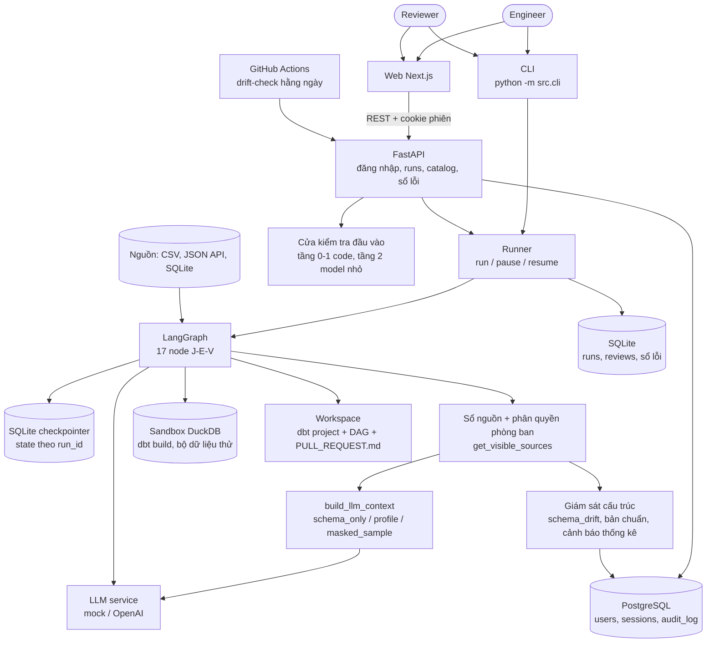

# Architecture Diagram

Sơ đồ chính (Archify): [adr/architecture.png](adr/architecture.png) • [adr/architecture.svg](adr/architecture.svg) •
[adr/architecture.html](adr/architecture.html). Hai sơ đồ Mermaid dưới đây là bản rút gọn, khớp sơ đồ chính và code
trong `src/agents/graph.py`.

## System Overview

## Agent Flow

```mermaid
graph LR
    NL([Yêu cầu NL]) --> G0{G0 Cửa kiểm tra đầu vào}
    G0 -->|vô nghĩa / lạc đề / tấn công| X([Từ chối, kèm ví dụ hợp lệ])
    G0 -->|thiếu thông tin| G0
    G0 -->|đạt| G1{G1 Kiểm tra cấu trúc nguồn}
    G1 -->|breaking đang mở| JD[/Engineer xác nhận cấu trúc mới/]
    JD --> E1
    G1 -->|không đổi, info, warning| E1[E1 Planner]
    E1 --> V0{V0 Soát spec}
    V0 -->|còn điểm chưa rõ| J1[/J1 Làm rõ/]
    J1 --> E1
    V0 -->|sai| E1
    V0 -->|đạt| J1b[/J1b DE duyệt kế hoạch/]
    J1b -->|sửa + ghi chú| E1
    J1b -->|đồng ý| E0[E0 Nhận nguồn] --> P[P Soi dữ liệu] --> Vs{Vs Soát cấu trúc nguồn}
    Vs -->|xóa/đổi tên cột| JS[/Engineer xác nhận/]
    JS --> E2[E2 Dữ liệu thử]
    Vs -->|không đổi hoặc chỉ thêm| E2
    E2 --> E3[E3 Coder] --> E3b[E3b Test-gen] --> V1{V1 An toàn}
    V1 -->|đạt| V2{V2 Sandbox}
    V1 -->|lỗi ≤3| E3
    V2 -->|lỗi ≤3| E3
    V1 & V2 -->|quá 3 lần / lỗi lặp| R[/Cứu hộ/]
    R -->|gợi ý| E3
    V2 -->|đạt| E4[E4 Optimizer]
    E4 --> V3{V3 Đối chiếu}
    V3 -->|lệch| E4
    V3 -->|applied: kiểm lại| V1
    V3 -->|skipped| PR[Pull Request<br/>Code đo / LLM nói]
    V2 -->|đạt, đã tối ưu| PR
    PR --> J2[/J2 Reviewer/]
    J2 -->|từ chối + ghi chú| E3
    J2 -->|duyệt| CI[CI/CD]
    J2 -.->|kiểm lại cấu trúc: breaking mới thì chặn nút Duyệt| G1
```

Ký hiệu: hình chữ nhật = agent (LLM) hoặc bước dữ liệu; hình thoi = kiểm chứng bằng code (0 token);
hình bình hành = con người.

## Component Details

| Component | Technology | Purpose |
|-----------|-----------|---------|
| CLI | argparse + rich | run, answer, review, status, errors, optimize, doctor, seed, eval, users |
| API | FastAPI | Đăng nhập, tạo/duyệt lần chạy, catalog, hồ sơ dữ liệu, sổ lỗi ([API.md](API.md)) |
| Web | Next.js 16 + TypeScript | Giao diện cho Engineer, Reviewer, Admin |
| Auth DB | PostgreSQL 17 + Alembic | Tài khoản, phiên, nhật ký kiểm toán, ảnh chụp cấu trúc nguồn ([DATABASE.md](DATABASE.md)) |
| Runner | LangGraph `interrupt` + `SqliteSaver` | Tạm dừng ở J1/J1b/J2/cứu hộ, tiếp tục từ tiến trình khác |
| Graph | LangGraph | 17 node: E (LLM), V (code), J (người) |
| LLM service | langchain-openai / mock | Cổng gọi LLM duy nhất, ghi token + chi phí |
| Sandbox | DuckDB + dbt-duckdb + sqlglot | Chạy thử không truy cập file ngoài, có timeout và giới hạn bộ nhớ |
| Store | SQLite | Lần chạy, quyết định duyệt, sổ lỗi (mục mới phải được Reviewer duyệt) |
| Schema guard | sqlglot + PostgreSQL | So cấu trúc nguồn với bản đã duyệt (`schema_snapshots`) |

## Khác biệt nhỏ so với sơ đồ Archify (để cân nhắc cập nhật sơ đồ)

- Hệ thống có thêm **CLI, Runner, Store/Checkpointer** (lớp vận hành) chưa vẽ trên sơ đồ.
- Cứu hộ: sơ đồ ghi "Engineer sửa tay, chạy lại V2"; code hiện tại cho Engineer **nhập gợi ý** → Coder sửa → V1 → V2
  (bản sửa vẫn qua kiểm tra an toàn). Chuyển cứu hộ khi quá 3 lần **hoặc** cùng một lỗi lặp 2 lần.
- Sau khi Optimizer áp dụng bản viết lại, code chạy lại V1 + V2 trước khi đóng gói Pull Request.
